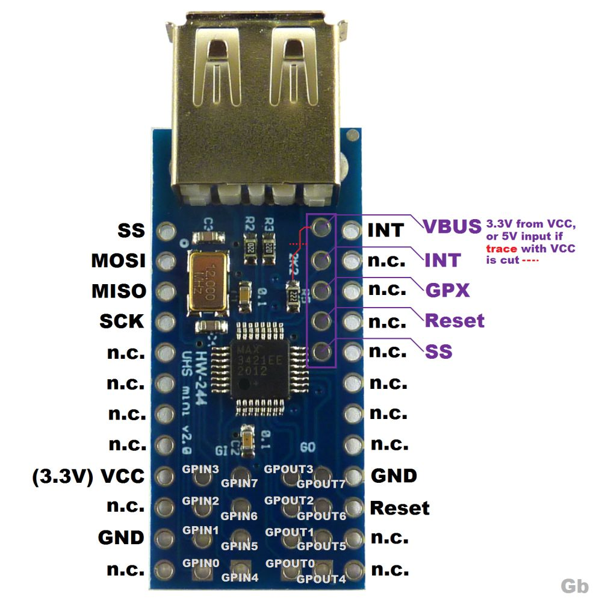
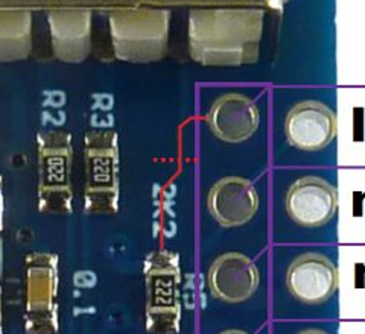

=====================================
Maxim MAX3421E USB Host Controller
=====================================

The MAX3421E is a USB 2.0 full-speed/low-speed host (or peripheral)
controller with an SPI interface.  It lets any MCU with an SPI port act as
a USB host, which is useful on parts that have no USB host controller of
their own (for example the STM32F103).

The NuttX driver lives in ``drivers/usbhost/usbhost_max3421e.c`` and
implements the standard USB host controller interfaces
(``struct usbhost_driver_s`` and ``struct usbhost_connection_s``), so all
the regular NuttX USB host class drivers (HID mouse, HID keyboard, mass
storage, CDC/ACM, ...) can be used on top of it.

.. note::

   The driver is still marked as experimental and depends on
   ``CONFIG_EXPERIMENTAL``.

Configuration
=============

``CONFIG_USBHOST_MAX3421E``
   Enable the driver.  It selects ``CONFIG_SPI`` and
   ``CONFIG_SCHED_LPWORK`` (the interrupt handling is deferred to the low
   priority work queue because the chip is accessed over SPI).

``CONFIG_MAX3421E_DESCSIZE``
   Maximum size of a descriptor.  Default: 128.

``CONFIG_MAX3421E_USBHOST_REGDEBUG``
   Dump every register access (very verbose, requires
   ``CONFIG_DEBUG_USB_INFO``).

``CONFIG_MAX3421E_USBHOST_PKTDUMP``
   Dump all incoming and outgoing USB packets (requires
   ``CONFIG_DEBUG_USB_INFO``).

Board Interface
===============

The board logic provides a ``struct max3421e_lowerhalf_s`` (see
``include/nuttx/usb/max3421e.h``) and calls
``max3421e_usbhost_initialize()``:

``spi``, ``frequency``, ``mode``, ``devid``
   The SPI bus instance, the SPI clock (up to 26 MHz), the SPI mode
   (``SPIDEV_MODE0`` or ``SPIDEV_MODE3``) and the device ID used with
   ``SPIDEV_USBHOST(devid)`` for the chip select.

``intconfig``
   How the INT pin signals interrupts.  ``0`` selects a push-pull,
   falling-edge interrupt, which is the natural choice for MCUs whose
   external interrupts are edge triggered (like the STM32 EXTI).
   ``USBHOST_PINCTL_INTLEVEL`` selects an open-drain, level active-low
   interrupt (a pull-up is then required).

``attach()``, ``enable()``, ``acknowledge()``, ``power()``
   Attach the driver interrupt handler to the INT GPIO, enable/disable it,
   acknowledge it, and switch VBUS on/off (if the board can).

The driver disables the GPIO interrupt while the interrupt work runs.  With
an edge triggered GPIO an edge that happens in that window is lost while
INT stays asserted, so ``enable()`` should check the INT level and dispatch
the handler immediately if INT is already active.

After initialization the board must start a thread that waits for
connection events and enumerates the devices::

  for (; ; )
    {
      CONN_WAIT(conn, &hport);
      if (hport->connected)
        {
          CONN_ENUMERATE(conn, hport);
        }
    }

Examples: ``boards/arm/stm32f1/stm32f103-minimum/src/stm32_max3421e.c``
and ``boards/arm/stm32f1/viewtool-stm32f107/src/stm32_max3421e.c``.

Low cost "USB Host Mini" module (HW-244)
========================================

A popular way to get a MAX3421E is the small blue "Mini USB Host Shield
2.0" module (silkscreen ``HW-244`` / ``UHS mini v2.0``).  It carries the
MAX3421E, its 12 MHz crystal and a USB-A socket.  All the useful signals are
on the two long edges; the pins marked ``n.c.`` and the ``GPIN``/``GPOUT``
pads can be left unconnected.

   HW-244 MAX3421E module pinout (picture from the Fritzing forum,
   https://forum.fritzing.org/t/max3421e-part-making/33489)

===========  ==========================================================
Pin          Function
===========  ==========================================================
SS           SPI chip select (active low)
MOSI         SPI data in
MISO         SPI data out
SCK          SPI clock
INT          Interrupt output
Reset        MAX3421E ``RES#`` input (active low)
GPX          General purpose output (not needed by the driver)
VCC          **3.3V** supply of the MAX3421E
GND          Ground
VBUS (pad)   Pin 1 (power) of the USB-A socket
===========  ==========================================================

Why the VBUS trace must be cut
------------------------------

The module has two different supplies:

* **VCC** powers the MAX3421E and its crystal.  The MAX3421E is a 3.3V
  part and the module has **no voltage regulator**, so VCC must be 3.3V.
  Never apply 5V to VCC.

* **VBUS** powers the USB device that is plugged into the USB-A socket.
  The USB specification requires 5V here.

To save parts, the module ties VBUS to VCC with a PCB trace, so the USB
device only gets 3.3V.  Some simple devices tolerate that, but most of them
(flash drives, many mice, keyboards and hubs) do not start, so the
MAX3421E never sees them connect.

The trace runs from the VBUS pad (the top pad of the column of five pads
near the USB socket) to the ``2K2`` resistor (R5).  Cut it at the place
marked with the red dotted line:

   The VBUS-to-VCC trace (red) and where to cut it (dotted line)

Procedure:

1. With a multimeter in continuity mode, check that VBUS and VCC are
   connected (it beeps).
2. Cut the trace with a sharp hobby knife until the fiberglass is visible.
   Keep away from the neighbouring pads and from R5.
3. Check again: VBUS and VCC must **not** be connected anymore, and VCC must
   not be shorted to GND.
4. Wire the VBUS pad to a 5V supply (for example the 5V pin of the MCU
   board when it is powered from USB).

.. warning::

   Do not connect 5V to the VBUS pad before confirming that the trace is
   open: it would put 5V on the 3.3V rail and can damage the MAX3421E and
   the MCU.

Notes
=====

* Keep the SPI, INT, Reset and GND wires short.  With long jumper wires a
  glitch on Reset or a corrupted SPI write (for example one that sets
  ``CHIPRES`` in ``USBCTL``) silently resets the chip: the registers return
  to their defaults while SPI keeps working.
* Prefer driving ``RES#`` from a GPIO and pulsing it at boot, so the chip
  always starts from a known state.
