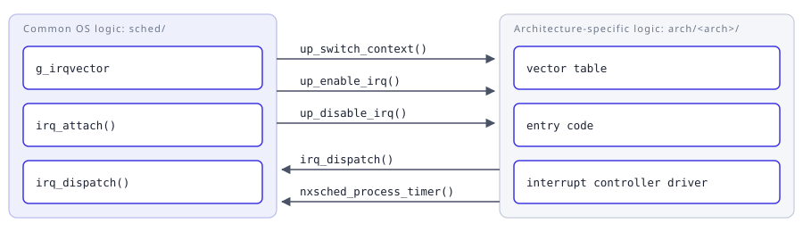

==========
Interrupts
==========

This page aims to explain the interrupt flow in NuttX. The idea is to show
since the moment where the peripheral / hardware event triggers the interrupt
line up to the moment where one thread returns its execution.

Where the code lives
====================

The NuttX interrupt subsystem code is split in two parts which one with a
clear and rigorous responsibility in order to ensure portability.

The common OS Logic
-------------------

This is the agnostic part, the common OS (operating system) logic, where the
code manages the interrupt logic regardless the architecture, i.e., it is
treated in a generic way. This code is located in ``sched/irq/`` and below it
is explained how this part is managed:

Where is the data stored?
~~~~~~~~~~~~~~~~~~~~~~~~~

In the NuttX, ``g_irqvector`` is a central data struct used by the kernel to
manage the interrupt request (IRQ). In simple terms, one table where NuttX
stores the pointers towards the interrupt handler functions (handlers/ISRs,
interrupt service routines) that was registered by the peripheral drivers.
Plus, this table also stores the handler argument. By the way, normally the
index is the IRQ number itself; with ``CONFIG_ARCH_MINIMAL_VECTORTABLE``, a
smaller table saves RAM (random access memory) and a map translates the IRQ
number into its position (If ``CONFIG_SCHED_IRQMONITOR`` is enabled, this
table will also stores statistics).

How does the register is being made?
~~~~~~~~~~~~~~~~~~~~~~~~~~~~~~~~~~~~

Via function ``irq_attach()``. This function is used by a peripheral driver to
register an interrupt handler with the NuttX kernel. This will tell to the
system which specific callback function should be executed whenever such a
particular interrupt request has been triggered. So, in other words, the
driver goes to the kernel and says: when this IRQ happens, then, call that
function.

So, when the function ``irq_attach(int irq, xcpt_t isr, void *arg)`` is
executed (usually during the driver/ subsystem bring-up), the function will:

1. validates whether the informed IRQ number is supported;

2. stores the handler function pointer (ISR) in the related position in the
   kernel internal table (with ``CONFIG_IRQCHAIN``, several functions could
   share the same IRQ and, therefore, the position starts to points to the
   chain).

3. Optionally associates a context argument (``arg``) that will be send to
   the handler when the trigger happens

In summary, ``irq_attach()`` is a pure pre-configuration routine that does not
handles the hardware itself, instead, just fill out the register table that
the Kernel will check later on. The exception is the removal: with a ``NULL``
handler (``isr``), it disables the line with ``up_disable_irq()``, when the
architecture allows it, before giving the position back to
``irq_unexpected_isr()``.

How is the handler called?
~~~~~~~~~~~~~~~~~~~~~~~~~~

The architecture layer calls ``irq_dispatch(int irq, void *context)``,
passing the identified IRQ number. This is where control passes from the
hardware-dependent part (specific architecture) to the agnostic core
(``sched/irq/``). There, ``irq_dispatch()``:

1. looks up ``g_irqvector`` with the IRQ number that was received;
2. finds and invokes the function pointer (handler) which was
   previously registered by the driver;
3. runs the handler routine on top of the current stack.

As soon as the driver handler finishes its job and returns to
``irq_dispatch``, the ``irq_dispatch()`` returns the control to the
architecture layer. If the handler has woken a thread with a higher priority,
that decision was already taken during the handler itself; now, the
architecture layer performs the context switch via
``nxsched_switch_context()``.

What is the logic so?
~~~~~~~~~~~~~~~~~~~~~

So, in a system without these protections (not NuttX), if in the
initialization the drivers have not registered anything yet, the table would
hold ``NULL`` pointers. In this case, when an interrupt arrives, a dispatcher
like ``irq_dispatch()`` (which is explained above) would try to call a
function at address zero and, as a result, we would have a hard fault with
no clue about which IRQ has broken the system.

To avoid such a problem, NuttX never leaves the table empty: in the
initialization, every entry points to ``irq_unexpected_isr()``.
``irq_dispatch()`` also falls back to ``irq_unexpected_isr()`` when it finds
an empty entry. So, if the IRQ line is released before the handler is
connected, any immediate event that comes from the peripheral calls this
function, which puts the system in panic (``PANIC()``) and, if
``CONFIG_DEBUG_ERROR`` is enabled, prints the number of the IRQ. Therefore,
the rule is: the driver registers its handler before enabling the interrupt
(usually during the bring-up phase).

The arch-specific Logic
-----------------------

Everything that varies from one chip to another chip remains confined in
``arch/<arch>/``, e.g.: ``arch/arm``, ``arch/risc-v``, ``arch/xtensa``, etc.

This layer holds the hardware interrupt vector table (not to be confused
with ``g_irqvector``, the table of the common logic), the low level entry
code that runs immediately after the event is triggered, and the drivers
that directly control the interrupt controller of the processor (such as
the NVIC, Nested Vectored Interrupt Controller, on Arm).

The trigger: when the peripheral activates its interrupt line, the
interrupt controller (such as the NVIC) captures the event and tells the
CPU, which uses the hardware vector table to divert the flow to the low
level entry code of the architecture (``arch/<arch>/``). The CPU and the
entry code save the context of the thread that was running.

The specific architecture code determines, hence, what IRQ number an specific
event belongs to and calls the function ``irq_dispatch``, given the control to
the common OS logic, as described above. Once ``irq_dispatch`` returns, the
specific arch-code resumes a thread execution (it could be a thread that was
interrupted, or other one (case the handler has been woken a major priority
thread; in such case after the switch control has been performed via
``nxsched_switch_context()``).

The two sides interact via a small set of functions. The common logic
requests that the architecture perform a thread switch using
``up_switch_context()``, and enable or disable an interrupt line using
``up_enable_irq()`` and ``up_disable_irq()`` (drivers also invoke these
two). In the opposite direction, the architecture calls ``irq_dispatch()``
for every interrupt it delivers, while the timer code calls
``nxsched_process_timer()`` to notify the scheduler that time has elapsed.
The ``up_*`` functions are described on the
:doc:`os/arch/arch_api </os/arch/arch_api>` page.

         irq_dispatch(), and the architecture-specific logic in arch/<arch>/
         holds the vector table, the entry code and the interrupt controller
         driver, with the functions that each one calls in the other.

   The common OS logic and the architecture-specific logic, and the
   functions each one calls in the other.

Interrupt and exception
=======================

The vocabulary changes from one architecture to another. For instance, on
Arm, "exception" is a general term that includes interrupts too. On the
other hand, on RISC-V, "exception" is only the event caused by an
instruction and, therefore, the general term in this architecture is
"trap", which means: the jump to the handler, caused by either an
interrupt or an exception.

In this page, an interrupt is the event that comes from outside, while
an exception is what arises from the instruction itself. In NuttX, as
described before, the architecture-specific layer (``arch/<arch>/``) manages
the hardware vector table and captures the event. There are two distinct
origins:

1. Asynchronous interrupts (interrupts):
   Triggered by sources external to the CPU (peripherals, GPIO (General
   Purpose Input/Output) pins, timers, or communication buses), they occur
   asynchronously with respect to the code the CPU is currently executing.

2. Synchronous exceptions (exceptions):
   Generated internally by the CPU itself as a direct result of the
   instruction that has just been executed (such as memory access
   violations, invalid instructions, or system calls). They are, hence,
   linked to the instruction that was running.

Despite their different origins, NuttX treats both in the same way: the
architecture layer converts each one into an IRQ number, and
``irq_dispatch()`` calls the handler registered via ``irq_attach()``.

What each kind of interrupt triggers
====================================

Although a microcontroller or SoC (System on Chip) may have dozens or even
hundreds of specific hardware interrupt lines, they all rely on the same
fundamental registration and dispatch mechanism (implemented via
``irq_attach()`` and ``irq_dispatch()``). An alternative approach, on some
architectures, involves "zero-latency" interrupts, which are designed to
intentionally bypass the ``irq_dispatch()`` routine. The
:doc:`zerolatencyinterrupts </guides/concurrency/zerolatencyinterrupts>`
page explains how and when to use them. Pretty much any event (physical or
logical) that changes the CPU flow falls into one of the following generic
classifications.

The typical sources of interrupts and the processes that follow their
respective handlers include:

The system timer: A hardware timer triggers at a fixed rate or, in
"tickless" mode, when the next timeout expires. Its handler calls
``nxsched_process_timer()``. Time advances, expired timeouts are processed,
and a thread whose wait has ended is moved to the "ready" state.

A peripheral: A device has data available, or its transmission buffer has
become empty. The driver's handler moves the data and releases a semaphore
using ``nxsem_post()``, which transitions a thread that was waiting for the
read operation back to the "ready" state.

Completion of a DMA (Direct Memory Access) transfer: The DMA engine has
independently moved a block of memory and reports its completion. Its
handler invokes a driver callback, which signals a semaphore, making a
thread that was waiting for the transfer "ready."

Software interrupt: A program intentionally executes a "trap"
instruction. NuttX uses this mechanism to request a context switch from a
thread and, when ``CONFIG_LIB_SYSCALL`` is enabled, to facilitate the
transition from user space to the kernel.

A fault: An instruction fails during execution. On armv7-m, for example,
a hard fault that cannot be handled results in a "kernel panic."

An IPI (Inter-Processor Interrupt): In symmetric multiprocessing (SMP)
environments, one CPU interrupts another, for instance, to signal that a
thread is ready to run on that specific core. The receiving CPU executes
``nxsched_process_delivered()``.

The path of an interrupt
========================

.. uml::
   :align: center
   :html_format: svg_img
   :alt: An interrupt is vectored by the architecture entry code, dispatched
         to the driver handler which does only what cannot wait, and the
         rest is handed to a work queue thread; on return the scheduler may
         switch to a different thread.
   :caption: From the peripheral asserting the line to the return, and where
             the work that cannot be done in a handler goes instead.

   skinparam shadowing false
   skinparam defaultFontColor #1b2233
   skinparam ArrowColor #4a5266
   skinparam ArrowThickness 1.5
   skinparam sequence {
     BoxBorderColor #c3cbd9
     BoxFontColor #6b7689
     ParticipantBackgroundColor #ffffff
     ParticipantBorderColor #3c34e3
     LifeLineBorderColor #4a5266
     LifeLineBackgroundColor #ffffff
     DividerBackgroundColor #f4f6fa
     DividerBorderColor #c3cbd9
     DividerFontColor #6b7689
     DelayFontColor #6b7689
   }
   skinparam participant<<hi>> {
     BackgroundColor #3c34e3
     BorderColor #2b2787
   }
   skinparam participant<<work>> {
     BorderColor #5a96bd
   }
   skinparam note {
     BackgroundColor #ffffff
     BorderColor #c3cbd9
     FontColor #3f4757
     FontStyle plain
   }
   skinparam sequenceMessageAlign right
   hide stereotype
   hide footbox

   !$s = "<size:10><color:#5a6478>"
   !$i = "<i>"

   box "HARDWARE AND ARCHITECTURE ENTRY\narch/<arch>/src/" #f4f6fa
     participant "vector, save context" as ENT
   end box
   box "COMMON OS LOGIC\nsched/irq/" #f4f6fa
     participant "irq_dispatch()" as DIS
   end box
   box "INTERRUPT HANDLER\nmust not block, wait or allocate" #eef0fb
     participant "<color:#ffffff>the driver's handler" as HND <<hi>>
     participant "work_queue()" as WQ <<work>>
   end box
   box "BOTTOM HALF\na worker thread, later" #f4f6fa
     participant "the work queue thread" as WRK <<work>>
   end box

   [-> ENT : IRQ asserted\n$s by a peripheral
   activate ENT
   note over ENT : $i nesting is the exception
   ENT -> DIS
   activate DIS
   note over DIS : $i find the handler
   DIS -> HND
   activate HND
   note over HND
     $i clear the cause,
     $i read the register
   end note
   HND -> WQ : $s hand off everything\n$s that can wait
   note left of WQ
     <i><color:#2b2787>Hand off what can wait.</color></i>
   end note
   WQ ->> WRK
   HND --> DIS
   deactivate HND
   DIS --> ENT
   deactivate DIS

   == RETURN FROM INTERRUPT ==

   ENT -> ENT : restore context
   note over ENT
     $i but not necessarily the same thread:
     $i a handler may have made a
     $i higher-priority thread ready. NuttX
     $i switches to it unless sched_lock() is
     $i held; under SMP the woken thread may
     $i go to another CPU instead.
   end note
   deactivate ENT

   ...later...

   WQ -[hidden]> WRK
   activate WRK
   note over WRK
     $i may block, may take a lock
   end note
   note over WRK
     $i The device is served here,
     $i where waiting is allowed.
   end note

When a peripheral (such as a UART (Universal Asynchronous
Receiver/Transmitter), timer, or bus controller) signals its dedicated IRQ
line, the interrupt controller intercepts the signal and notifies the CPU.
The CPU interrupts the currently executing thread (let's call it
Thread A) and redirects the execution flow to the architecture-specific
entry code. Together, the CPU and the architecture code save the context,
allowing Thread A to be resumed later, identify the IRQ number, and call
``irq_dispatch()``, which triggers the driver's handler. Once the handler
finishes, the CPU resumes the execution of a thread.

It is very common for the handler to wake up a higher-priority thread that
was waiting for the event (let's call it Thread B), for instance, by
releasing a semaphore via ``nxsem_post()``. When this occurs, NuttX applies
preemptive scheduling: instead of restoring the context of Thread A, the
kernel switches directly to Thread B (unless Thread A has preemption
disabled via ``sched_lock()``). In SMP systems, this newly awakened thread
may be dispatched to another core.

.. uml::
   :align: center
   :html_format: svg_img
   :alt: Timeline: Thread A runs, an interrupt arrives, the handler calls
         nxsem_post() and makes the higher-priority Thread B ready, and on
         return Thread B runs; if Thread A holds sched_lock(), Thread A
         resumes and Thread B waits.
   :caption: Returning from an interrupt may resume a different thread.

   skinparam shadowing false
   skinparam defaultFontColor #1b2233
   skinparam ArrowColor #4a5266
   skinparam ArrowThickness 1.5
   skinparam sequence {
     ParticipantBackgroundColor #ffffff
     ParticipantBorderColor #3c34e3
     LifeLineBorderColor #4a5266
     LifeLineBackgroundColor #ffffff
     GroupBorderColor #c3cbd9
     GroupBackgroundColor #f4f6fa
     GroupHeaderFontColor #6b7689
     GroupFontColor #6b7689
   }
   skinparam participant<<hi>> {
     BackgroundColor #3c34e3
     BorderColor #2b2787
   }
   skinparam note {
     BackgroundColor #ffffff
     BorderColor #3c34e3
     FontStyle plain
   }
   hide stereotype
   hide footbox

   !$on = "<color:#ffffff>"
   !$son = "<size:10><color:#d9d7fb>"
   !$s = "<size:10><color:#5a6478>"
   !$n = "<i><color:#3f4757>"

   participant "Thread A" as A
   participant "$on interrupt handler" as H <<hi>>
   participant "Thread B" as B

   alt Thread A does not hold sched_lock()
     rnote over A
       Thread A runs
       $s interrupted here
     end rnote
     A -> H : $s interrupt
     activate H
     rnote over H #3c34e3
       $on handler, on top of Thread A
       $son nxsem_post(): Thread B ready
     end rnote
     H -> B : $s return
     deactivate H
     rnote over B
       Thread B runs
       $s not Thread A
     end rnote
   else Thread A holds sched_lock()
     rnote over A
       Thread A runs
       $s interrupted here
     end rnote
     A -> H : $s interrupt
     activate H
     rnote over H #3c34e3
       $on handler, on top of Thread A
       $son nxsem_post() wakes Thread B
     end rnote
     H -> A : $s return
     deactivate H
     rnote over A
       Thread A resumes
     end rnote
     rnote over B
       $s Thread B waits
     end rnote
   end

   note across #f4f6fa
     $n Thread B has a higher priority than Thread A.
     $n Time runs from top to bottom.
     $n Under SMP, Thread B may run on another CPU instead.
   end note

To make this possible, the work is divided among the kernel layers: the
common OS logic decides which thread should run next (by placing Thread B
into the ready-to-run list), while the architecture-specific logic carries
out the context switch once the handler finishes.

Therefore, exiting an interrupt does not necessarily mean returning to the
same thread that was interrupted.

What a handler may do
=====================

An interrupt handler is not a thread. ``irq_dispatch()`` invokes it like a
standard function, executing within the context of the thread that was
interrupted (Thread A). Consequently, any call that acts upon "the current
thread" affects Thread A, not the handler itself.

For this reason, a handler must not block. NuttX does not always prevent
a handler from calling a blocking function; adhering to this rule is the
responsibility of the driver developer. Any operation that requires waiting,
allocating memory, or acquiring a lock that might cause the thread to sleep
(such as a mutex or a semaphore) must be deferred, which is the purpose of
"bottom halves" and "work queues" (see
:doc:`bottomhalf_interrupt <bottomhalf_interrupt>`). If a handler requires a
counting semaphore, it should use ``nxsem_trywait()`` (the kernel form of
``sem_trywait()``), which attempts to acquire the semaphore without
blocking; if the semaphore is unavailable, it returns immediately.

A spinlock is different: it spins rather than sleeps. When a handler in an
SMP environment requires one, it acquires it using ``spin_lock_irqsave()``.

Allocating memory is also unsafe. ``malloc()`` acquires a heap lock; if a
thread happens to hold this lock when an interrupt occurs (or, in an SMP
system, at any time), the allocation will either trigger an assertion (if
``CONFIG_DEBUG_ASSERTIONS`` is enabled) or result in the heap being accessed
without the necessary lock.

When deferred work requires its own thread, ``irq_attach_thread()`` creates
a kernel thread for the interrupt, while ``irq_attach_wqueue()`` offloads the
work to an interrupt work queue (which requires ``CONFIG_SCHED_WORKQUEUE``).
In both cases, the ``isr`` argument runs in interrupt context; if it is not
``NULL``, the thread will only execute once the ``isr`` returns
``IRQ_WAKE_THREAD``.

Nesting
=======

On most architectures, an interrupt handler is not interrupted by another
interrupt. Nesting is the exception rather than the rule, and the
:doc:`nestedinterrupts </guides/concurrency/nestedinterrupts>` page covers
this scenario.

The interrupt stack
===================

An interrupt handler requires a stack. Where the architecture supports it,
``CONFIG_ARCH_INTERRUPTSTACK`` provides handlers with a dedicated stack of a
specified size (in bytes). The default value is 0, in which case the handler
runs on the stack of the interrupted thread, which must, therefore, have
sufficient space to accommodate it. SMP configurations require a value other
than 0.

Protecting code from interrupts
===============================

For protecting a section of code, note that disabling interrupts and locking
pre-emption are not the same choice and do not cost the same. See
:doc:`Critical Sections <critical_sections>` for the difference, and
:doc:`Effects of Disabling Interrupts or Pre-Emption on Response Latency
</os/scheduling/preemption_latency>` for what each one does to response time.

.. toctree::
   :maxdepth: 1

   interrupt_controls.rst
   critical_sections.rst
   bottomhalf_interrupt.rst
