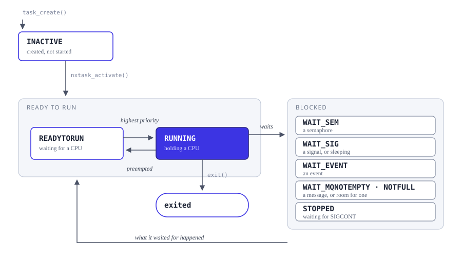
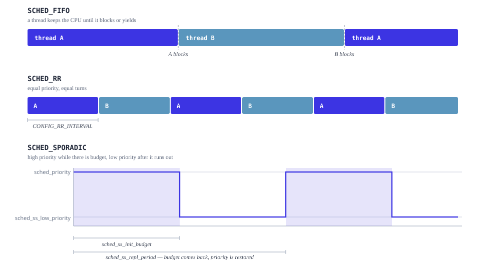

==========
Scheduling
==========

The scheduler is the part of the operating system that decides which
thread will run.  In NuttX, a thread can be a task, a pthread or a kernel
thread (the differences are in :doc:`tasks_vs_threads` and
:doc:`kernel_threads_vs_pthreads`).

In this context, whenever a thread finishes its job, waits for something
(a semaphore, a message, a sleep), or is paused by another one with a
higher priority, the scheduler is responsible for orchestrating it.  This
orchestration happens with other elements as well.  The context switch is
responsible for the thread swap.  The kernel itself helps the scheduler by
providing a TCB (Task Control Block) for every thread.  The TCB holds the
thread's context, such as its priority, current state, and saved CPU
registers.

How does the NuttX scheduler make this orchestration?  The first rule is
to check the threads' priorities: among the threads that are ready to
run, the one with the higher priority number runs first.  When two threads
have the same priority, the scheduling policy decides who runs first and,
in NuttX, there are three: ``SCHED_FIFO``, ``SCHED_RR`` and
``SCHED_SPORADIC``.  The last two can be used only when they are enabled
in the configuration.

The scheduler itself is in ``sched/sched/``.  Threads are created, and
get their first priority and policy, in ``sched/task/`` and
``sched/pthread/``.  The thread states and the TCB are defined in
``include/nuttx/sched.h``, and each architecture does the context switch
under ``arch/``.

Priority comes first
====================

On a single core, the moment a higher-priority thread becomes ready, it
takes the CPU, unless preemption is locked with ``sched_lock()`` (see
below).  When an interrupt handler makes it ready, the switch happens as
the interrupt returns.  See :doc:`/os/interrupts/index`.

Nowadays many chips have more than one core.  That is why NuttX has SMP
(symmetric multiprocessing) as a build option, ``CONFIG_SMP``.  A dual
core chip does not run in SMP by default: if ``CONFIG_SMP`` is not set,
NuttX uses just one core.  Once ``CONFIG_SMP`` is enabled, NuttX uses the
cores at the same time, each one running its own thread.  The option exists
only on chips whose port supports several CPUs, so not every MCU has it;
the NuttX simulator (``sim:smp``) is an easy way to try it.

With ``CONFIG_SMP``, a lower-priority thread can run on one core while a
higher-priority thread runs on another.  Every thread has an affinity
mask, the set of cores where it is allowed to run, and the scheduler only
picks a core inside that mask.  When a core looks for the next thread to
run, the scheduler goes through the ready-to-run list and takes the one
with the highest priority.  If the mask of that thread does not allow this
core, the scheduler skips it and looks at the next one in the list.  This
shows a situation that may happen: a higher-priority thread can wait in
the queue while a thread with a lower priority runs.  By default the mask
holds every core, so NuttX chooses where each thread runs; an application
narrows the mask with ``sched_setaffinity()`` (see below).

When a thread becomes ready, the scheduler first looks for an idle core in
its mask; if there is one, the thread runs there at once.  If no core is
idle, the scheduler picks the core that is running the lowest-priority
thread, and the new thread takes it only if its own priority is higher.

In NuttX, priorities go from 1 (``SCHED_PRIORITY_MIN``) up to 255
(``SCHED_PRIORITY_MAX``).  The higher the number, the higher the priority
of the thread.  A priority is not static, and there are four ways it can
change:

- **Application definition:** an application sets the initial priority of
  a thread when it is created, or later with ``sched_setparam()``,
  ``sched_setscheduler()`` or ``pthread_setschedparam()``.
- **Sporadic policy:** the system moves the priority of a sporadic thread
  between two levels, a higher one during its budget and a lower one when
  the budget ends (see below).
- **Priority inheritance** (``CONFIG_PRIORITY_INHERITANCE``): a thread
  that holds a resource is temporarily raised to the priority of a
  higher-priority thread that is waiting for it.
- **Priority protection, or ceiling** (``CONFIG_PRIORITY_PROTECT``): a
  thread that locks a mutex with a priority ceiling is raised to that
  ceiling while it holds the lock.

See :doc:`/os/ipc/index` for inheritance and protection.

Thread states
=============

Every thread is in exactly one state, held in its task control block.  The
states are defined by ``enum tstate_e`` in ``include/nuttx/sched.h``, and the
comment beside each one sorts it into a group: ``INVALID`` for a TCB that has
not been initialised, ``READY_TO_RUN``, and ``BLOCKED``.

         onto a CPU, blocks waiting for a resource, and finally exits.

   The states of ``enum tstate_e``, and what moves a thread between them.
   ``exited`` is not a state: it is where the thread's TCB is released.

A thread's life follows the arrows.  ``task_create()`` builds the TCB in
the ``INACTIVE`` state and then calls ``nxtask_activate()``, which puts
it on the ready-to-run list; from there, priority decides whether it
takes the CPU at once.  A ``RUNNING`` thread that asks for something not
yet available (a semaphore at zero, a signal, an event, a message from
an empty queue or room in a full one) leaves the CPU and moves to the
``WAIT_*`` state that names the reason.  When that happens, it goes back
to the ready-to-run list.  A thread ends when it returns from its entry
function or calls ``exit()`` or ``pthread_exit()``.  Another thread can
also end a task with ``task_delete()``, even while it is blocked; see
:doc:`/reference/user/01_task_control` for when the call is refused or
deferred.  Either way the kernel releases the TCB.

``INACTIVE`` carries the ``BLOCKED`` comment as well, though it is not
waiting on anything: it is a thread that has been created and not yet
activated.

The ready-to-run group has four states: ``READYTORUN``, ``RUNNING``,
``ASSIGNED`` and ``PENDING`` (three without ``CONFIG_SMP``, which drops
``ASSIGNED``).  The diagram shows the first two; the other two are left
off to keep it readable, and they are not alike.  ``ASSIGNED`` is
``READYTORUN`` with a CPU already picked, and it is the conditional one:
it exists only under ``CONFIG_SMP``.  ``PENDING`` is always compiled, but
only the non-SMP scheduler uses it.  Without ``CONFIG_SMP``,
``nxsched_add_readytorun()`` puts a thread there when the running thread
holds ``sched_lock()`` (``nxsched_islocked_tcb(rtcb)``) **and** the new
thread has a higher priority, so it would have preempted the running
thread.  A thread that becomes ready at equal or lower priority under the
lock joins the ordinary ready-to-run list instead.  A ready thread can
also move to ``PENDING`` when the thread holding the lock lowers its own
priority to that thread's level or below, as ``sched_yield()`` does under
the lock.  With ``CONFIG_SMP`` no thread enters ``PENDING``: a thread that
becomes ready stays in the ready-to-run list, and ``sched_unlock()``
checks that list instead.

A thread in any *ready-to-run* state is runnable: it waits only for its
turn.  Only one thread per CPU is ``RUNNING``.  A thread in any
*blocked* state is waiting for something specific, and the state says
what: a semaphore (``WAIT_SEM``), a signal (``WAIT_SIG``), an event
(``WAIT_EVENT``), a message to arrive (``WAIT_MQNOTEMPTY``), or room to
put one (``WAIT_MQNOTFULL``).  ``WAIT_EVENT`` exists only under
``CONFIG_SCHED_EVENTS``, and the two message states only while POSIX or
System V message queues are enabled, that is, unless both
``CONFIG_DISABLE_MQUEUE`` and ``CONFIG_DISABLE_MQUEUE_SYSV`` are set.  A
thread stopped by ``SIGSTOP``, ``SIGTSTP``, ``SIGTTIN`` or ``SIGTTOU``
waits in ``STOPPED`` for ``SIGCONT``, under
``CONFIG_SIG_SIGSTOP_ACTION``.  One more state is off the diagram:
``WAIT_PAGEFILL``, under ``CONFIG_LEGACY_PAGING``.  Sleeping is not a
state of its own: ``TSTATE_SLEEPING`` is defined as another name for
``TSTATE_WAIT_SIG``, so a sleeping thread shows as waiting for a
signal.  This is why the task list that NuttX prints after a failed
assertion (with ``CONFIG_SCHED_DUMP_TASKS``) and ``/proc/<pid>/status``
(with ``CONFIG_FS_PROCFS``) tell you not just that a thread is stuck but
what it is stuck on.

Scheduling policies
===================

The policy applies **between threads of equal priority**.  It never lets a
lower-priority thread run ahead of a higher-priority one.  With
``CONFIG_SMP`` a lower-priority thread can still run at the same time on
another CPU, as described above.

         yields; under SCHED_RR threads of equal priority take turns;
         under SCHED_SPORADIC a thread runs at a high priority while it
         has budget and drops to a low one when the budget is spent.

   The same two threads under each policy, and what the sporadic parameters
   mean.

``SCHED_FIFO`` -- run to completion
-----------------------------------

FIFO stands for *first in, first out*.  A thread runs until it blocks,
yields, exits, or is preempted by something of higher priority.  Two
threads of the same priority do not share a CPU: the first one to start
keeps it until it gives it up.

This is the most predictable policy and the cheapest one, and a new task
gets it only while round robin is switched off, that is, while
``CONFIG_RR_INTERVAL`` is 0.  That is the Kconfig default, but
most board configurations set a positive value, so in most of those
configurations a new task gets ``SCHED_RR``.
``nxthread_setup_scheduler()`` picks the policy for every new TCB with a
compile-time test, not a runtime one: ``TCB_FLAG_SCHED_RR`` and a timeslice
of ``CONFIG_RR_INTERVAL`` when that value is positive,
``TCB_FLAG_SCHED_FIFO`` otherwise.  So ``CONFIG_RR_INTERVAL`` is not a
per-thread opt-in; setting it changes the default policy of the whole
system.

``SCHED_RR`` -- take turns
--------------------------

RR stands for *round robin*.  Same as ``SCHED_FIFO``, except that a
thread which has been running for ``CONFIG_RR_INTERVAL`` milliseconds,
rounded up to whole system ticks, is moved to the back of the queue of
threads at its own priority, and the next one runs.

``CONFIG_RR_INTERVAL`` counts milliseconds and defaults to 0, which
disables the policy entirely.  *Entirely* is literal: at 0 the
``SCHED_RR`` case is not compiled into ``nxsched_set_scheduler()`` at
all, so asking for the policy at run time fails with ``EINVAL`` rather
than being ignored, and ``pthread_attr_setschedpolicy()`` rejects it
too.  Set it to a positive value and, as above, every new thread starts
out round-robin, tasks and pthreads alike (a pthread created with
``PTHREAD_INHERIT_SCHED`` takes its parent's policy instead).  Use it
when several threads of the same priority have to make progress
together, and none of them blocks often enough to give the others a
chance on its own.

For example, with ``CONFIG_RR_INTERVAL`` set to 200, a ``SCHED_RR``
thread runs for about 200 milliseconds.  Then, if another thread of the
same priority is ready, the scheduler moves it to the back of the queue and
runs the next one, and so on.  A thread of higher priority does not wait
for the slice to end: it takes the CPU at once.  The kernel converts this
time into system ticks, rounding up.  The tick period is
``CONFIG_USEC_PER_TICK``, 10 ms by default when the system is not
tickless (100 interrupts per second, or 100 Hz).

.. note::

   Larger slices make round robin behave more like ``SCHED_FIFO``.

``SCHED_SPORADIC`` -- a budget per period
-----------------------------------------

Enabled by ``CONFIG_SCHED_SPORADIC``.  This one is worth understanding
before reaching for it, because it behaves unlike the other two.

Even when ``CONFIG_SCHED_SPORADIC`` ("Support sporadic scheduling") is
enabled, no thread uses it by default: a thread becomes sporadic only when
the application asks for it, with ``sched_setscheduler()``,
``pthread_setschedparam()`` or the attributes of a new pthread.  So a
system can have, at the same time, one ``SCHED_FIFO`` thread, several
``SCHED_RR`` threads and one ``SCHED_SPORADIC`` thread, and all of them
obey the same rule: priority first.

A sporadic thread has **two** priorities and a **budget**:

.. list-table::
   :header-rows: 1
   :widths: 34 66

   * - ``struct sched_param`` field
     - Meaning
   * - ``sched_priority``
     - The high priority.  The thread runs at this priority while it still
       has budget left.
   * - ``sched_ss_low_priority``
     - The low priority.  The thread drops to this once the budget is spent.
   * - ``sched_ss_init_budget``
     - How much CPU time the thread may spend at the high priority.  A
       ``struct timespec``.
   * - ``sched_ss_repl_period``
     - The length of one cycle, budget included.  Also a ``struct
       timespec``.
   * - ``sched_ss_max_repl``
     - How many replenishments may be pending at once, from 1 to
       ``CONFIG_SCHED_SPORADIC_MAXREPL``.

How the fields work together, in order:

#. While the thread has budget, it competes at ``sched_priority`` and
   responds quickly.
#. When the budget runs out, it drops to ``sched_ss_low_priority`` and
   runs only while no thread of a higher priority than that is ready.
#. The cycle has a fixed length, ``sched_ss_repl_period``, counted from
   its start, not from the end of the budget: the period *contains* the
   budget, and ``sched_sporadic.c`` spends the rest of it,
   ``repl_period - budget``, at the low priority.  With a 10 ms budget
   and a 100 ms period, the thread runs high for up to 10 ms, low for
   the other 90, and is promoted again 100 ms after the cycle began.
#. If it stops running part-way through its budget, preempted or
   blocked, the time it lost is given back later as a *replenishment*
   that starts half a period after it stopped.  ``sched_ss_max_repl``
   caps how many replenishments may be pending at once.

The budget may be at most half the period, a limit of the current
implementation: ``nxsched_validate_sporadic()`` returns ``-EINVAL`` for
a larger one, so ``sched_setscheduler()``, ``sched_setparam()`` and
``pthread_create()`` all reject it.

What this buys you is a **bounded** amount of high-priority CPU time for a
thread whose workload you do not fully trust: an event handler that is
usually short but occasionally is not.  It gets to respond quickly, and it
cannot starve the rest of the system if it misbehaves.  A thread that would
otherwise have to be given a low priority (and therefore a poor response
time) can be given a high one safely.

Choosing a policy
=================

.. list-table::
   :header-rows: 1
   :widths: 22 78

   * - Policy
     - Use it when
   * - ``SCHED_FIFO``
     - Threads of the same priority do not have to take turns: each runs
       until it blocks or yields.  The most predictable and the cheapest
       policy.
   * - ``SCHED_RR``
     - Several threads sit at the same priority and all have to progress,
       for example a set of equivalent workers.  Needs
       ``CONFIG_RR_INTERVAL`` above 0.
   * - ``SCHED_SPORADIC``
     - A thread needs a fast response but its running time is not bounded,
       and starving lower-priority work is not acceptable.  Needs
       ``CONFIG_SCHED_SPORADIC``.

``SCHED_OTHER`` and ``SCHED_NORMAL`` exist for portability and are both 0;
``SCHED_NORMAL`` is defined as an alias of ``SCHED_OTHER``, which the header
describes as mapping to ``SCHED_FIFO`` or ``SCHED_RR``.  In the code that
mapping goes to ``SCHED_RR`` and only while ``CONFIG_RR_INTERVAL`` is
positive: ``nxsched_set_scheduler()`` compiles ``case SCHED_OTHER`` next to
``case SCHED_RR`` under that same test.  At 0, ``SCHED_OTHER`` is still
accepted.  ``sched_setscheduler()`` then sets only the priority and leaves
the thread's policy as it was, and a thread that ``pthread_create()``
starts with an explicit ``SCHED_OTHER`` attribute gets ``SCHED_FIFO``.

``include/sched.h`` also defines ``SCHED_BATCH`` and ``SCHED_IDLE``.
Nothing else in the source code uses either name, and
``nxsched_set_scheduler()`` does not accept either, so asking for one
fails.  They are numbers reserved in a header, not policies you can
select.

Application interface
=====================

The POSIX interface to all of the above (``sched_setscheduler()``,
``sched_setparam()``, ``sched_yield()``, ``sched_rr_get_interval()`` and the
rest) is documented in :doc:`/reference/user/02_task_scheduling`.

Two more interfaces are worth naming here:

``sched_lock()`` / ``sched_unlock()``
   Hold off the scheduler without disabling interrupts.  Interrupts still
   run; what is suspended is the switch to another thread.  Calls nest:
   the lock is a per-thread count, and preemption comes back only when
   every ``sched_lock()`` has been matched by a ``sched_unlock()``.
   Without ``CONFIG_SMP``, a thread that becomes ready while preemption
   is locked goes to ``PENDING``, provided it would have preempted the
   thread holding the lock; with ``CONFIG_SMP`` it stays in the
   ready-to-run list.  This is cheaper and far less disruptive than
   disabling interrupts, and it is almost always the right tool when the
   goal is "do not switch away from me" rather than "do not interrupt
   me".  See :doc:`preemption_latency` for what each choice costs.  It is
   not a lock for shared data: under ``CONFIG_SMP`` the other CPUs keep
   running, and interrupt handlers run on every CPU.  To protect data
   shared between threads, use a mutex or a semaphore (see
   :doc:`/os/ipc/index`); for data shared with an interrupt handler, see
   :doc:`/os/interrupts/critical_sections`.

``sched_setaffinity()`` / ``sched_getaffinity()``
   Restrict a thread to a set of CPUs under ``CONFIG_SMP``.  By default
   the set holds every CPU (``CONFIG_SMP_DEFAULT_CPUSET``), so NuttX
   picks the CPU, and a new thread inherits the set of its parent.  For
   a pthread, ``pthread_attr_setaffinity_np()`` sets it before creation
   and ``pthread_setaffinity_np()`` changes it afterwards.  A set with a
   single CPU pins the thread to that CPU.  See :doc:`smp`.

In this section
===============

.. toctree::
   :maxdepth: 1

   nuttx_tasking.rst
   tasks_vs_threads.rst
   kernel_threads_vs_pthreads.rst
   processes_vs_tasks.rst
   context_switches.rst
   preemption_latency.rst
   cancellation_points.rst
   smp.rst
   wqueue.rst
   tls.rst
   user_identity.rst
   capabilities.rst
