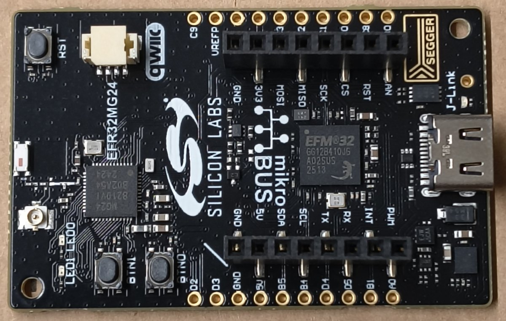

=============================================
Silicon Labs EFR32xG24 Explorer Kit (EK2703A)
=============================================

.. tags:: chip:efr32, arch:arm, vendor:silabs

   EFR32xG24 Explorer Kit (BRD2703A)

The EFR32xG24 Explorer Kit (xG24-EK2703A, board BRD2703A) is a small
development board from Silicon Labs with an EFR32MG24B210F1536IM48 wireless
SoC (Cortex-M33, 1536 KB flash, 256 KB RAM). The board includes an on-board
SEGGER J-Link debugger with a virtual COM port on its USB Type-C connector.

Features
========

* EFR32MG24B210F1536IM48 SoC, +10 dBm 2.4 GHz radio with a PCB antenna
* 39 MHz HFXO crystal and 32.768 kHz LFXO crystal
* Two user LEDs and two user buttons
* On-board J-Link debugger with a virtual COM port and packet trace
* mikroBUS socket, Qwiic connector and 20 breakout pads
* Powered from the USB Type-C connector

NuttX does not support the radio, the mikroBUS socket (SPI, I2C, UART) or
the Qwiic connector (I2C) yet.

Buttons and LEDs
================

==========  ======  ===================================
Name        Pin     Use
==========  ======  ===================================
LED0        PA4     OS state (CONFIG_ARCH_LEDS) or user LED, active high
LED1        PA7     Panic (CONFIG_ARCH_LEDS) or user LED, active high
BTN0        PB2     User button, active low
BTN1        PB3     User button, active low
==========  ======  ===================================

With ``CONFIG_ARCH_LEDS``, LED0 turns on when the idle stack has been
created and LED1 blinks on a panic. Otherwise the LEDs are user LEDs
(``/dev/userleds`` with ``CONFIG_USERLED``).  The buttons are available
through ``/dev/buttons`` with ``CONFIG_INPUT_BUTTONS``; they interrupt on
press and release (``CONFIG_ARCH_IRQBUTTONS``, which needs
``CONFIG_EFR32_GPIO_IRQ``).

Serial Console
==============

The console is USART0 on PA5 (TX) and PA6 (RX), routed to the virtual COM
port of the on-board debugger, at 115200 8N1. The kit user guide calls this
port "USART1"; the EFR32MG24 has only USART0, which drives these pins here.
It is enabled with ``CONFIG_EFR32_USART0`` and ``CONFIG_USART0_SERIAL_CONSOLE``.

Pin Mapping
===========

=======  ==========  ==================================
Pin      Signal      Notes
=======  ==========  ==================================
PA1      SWCLK       Debugger
PA2      SWDIO       Debugger
PA3      SWO         Debugger
PA4      LED0
PA5      USART0_TX   Serial console (VCOM TX)
PA6      USART0_RX   Serial console (VCOM RX)
PA7      LED1
PA8      VCOM_RTS    Not used
PA9      VCOM_CTS    Not used
PB2      BTN0
PB3      BTN1
=======  ==========  ==================================

Power Supply
============

The kit is powered from the USB Type-C connector of the on-board debugger.

Installation
============

The build needs the ``arm-none-eabi`` GNU toolchain. Flashing uses Silicon
Labs Simplicity Commander, which talks to the on-board J-Link.

Building NuttX
==============

.. code:: console

   $ ./tools/configure.sh xg24-ek2703a:nsh
   $ make -j

``CONFIG_EFR32_HFXO_CTUNE`` sets the HFXO tuning capacitance used when the
user data page holds no factory value.

Flashing
========

With Simplicity Commander through the on-board J-Link:

.. code:: console

   $ commander flash nuttx.hex --device EFR32MG24B210F1536IM48

Configurations
==============

.. code:: console

   $ ./tools/configure.sh xg24-ek2703a:<config-name>

nsh
---

NuttShell on USART0 at 115200 baud through the virtual COM port of the
on-board debugger, with ``/dev/userleds`` and ``/dev/buttons``.

ostest
------

``nsh`` with :doc:`ostest </applications/testing/ostest/index>`.
