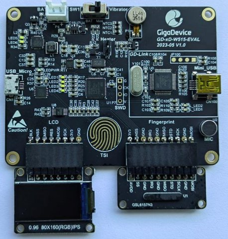

===============
GD-xD-W515-EVAL
===============

.. tags:: arch:arm, chip:gd32w51x, vendor:gigadevice

The GigaDevice GD-xD-W515-EVAL is an "all-in-one" evaluation kit for smart
locks and portable HMI devices, built around the GD32W515PIQ6 (Cortex-M33,
2 MB flash, 448 KB SRAM). It is made of a main board, a fingerprint board
and an LCD board.

   The GD-xD-W515-EVAL with its LCD and fingerprint boards (photo: CNX
   Software).

Features
========

- GD32W515PIQ6 MCU, 25 MHz crystal, no 32 kHz crystal
- 0.96" 160x80 IPS LCD (ST7735S, SPI) with a switched backlight
- GSL6157 capacitive fingerprint sensor (SPI)
- Capacitive touch key (TSI), vibration motor, heater coil, microphone,
  four LEDs
- GD25Q128E 16 MB QSPI NOR flash (U6)
- GD30BC2416 battery charger, GD30LD1002 LDO, LiPo connector
- On-board GD-Link (CMSIS-DAP) on the mini-USB connector
- CH340E USB-serial bridge on the micro-USB connector

The integrated Wi-Fi radio cannot be used on this board: the vendor radio
libraries only support 26 MHz and 40 MHz crystals.

Pin mapping
===========

The pins below follow the board schematic (GD-xD-W515-EVAL V1.0,
GigaDevice, 2023-05).

============== ==================================== ==========================
Function       Pins                                 Notes
============== ==================================== ==========================
Console        PB10 (TX), PB11 (RX), AF7            USART2, to the CH340E
LCD (SPI0)     PA11 (SCK), PA9 (MOSI), AF0          Write only
LCD control    PA10 (D/C), PB13 (CS), PC6 (RESET)
LCD backlight  PC14 (active high)                    On with the display
Motor          PA0, TIMER1_CH0 (AF1)                /dev/pwm0 channel 1
LEDs           PC5, PC4, PB0, PB1                   LED1..LED4, active high
I2C0           PB15 (SCL, AF4), PA8 (SDA, AF5)      GD30BC2416 charger
Touch key      PB12 (sampling), PB14 (channel)      TSI, AF4, /dev/buttons
Heater coil    PB7 (COIL_EN, active low)            /dev/gpio0 (output)
Fingerprint    PC7 (SCK), PB6 (MISO), PB9 (MOSI)    SPI1, AF5 (no driver yet)
Fingerprint    PB8 (CS), PB5 (SHUTDOWN)             Outputs
Fingerprint    PA12 (IRQ)                           /dev/gpio2 (interrupt)
USB detect     PC1 (micro-USB VBUS / 2)             /dev/gpio1 (interrupt)
Charger IRQ    PB2                                  GD30BC2416 driver (*)
Charger enable PC3 (CHRG_EN, active high)           Held high
Analog inputs  PA1, PA2, PA3, PC2                   ADC channels 1/2/3/6 (*)
GD-Link VBUS   PC0 (mini-USB VBUS / 2)              ADC channel 4 (*)
Microphone     PA15 (MIC_OUT)                       Digital input
QSPI flash     PA4 (SCK), PA5 (CS)                  GD25Q128E, AF3
QSPI flash     PA6, PA7, PB3, PB4                   IO0..IO3, AF3
============== ==================================== ==========================

(*) The analog inputs are the NTC thermistors of the heater coil (PA1),
of the battery (PA2) and of the USB connector (PA3), each a 10 kOhm NTC
with a 10 kOhm pull-up to 3.3 V, and the battery current (PC2): an
INA181A1 (gain 20) on a 20 mOhm shunt with a 1.8 V offset, so
``I = (V - 1.8) / 0.4`` A, negative while the battery charges. PC0 is the
GD-Link USB supply through a 10 kOhm / 10 kOhm divider: about 2.5 V with
the GD-Link cable plugged in, near 0 V without it. The battery voltage is
only measured by the charger. PB2 is ``/dev/gpio3`` when the
charger driver is disabled.

Fingerprint sensor
==================

The GSL6157 sensor (160x36 pixels, Silead / GigaDevice) is on SPI1. Its
module is wired as the reference circuit of the GSL6157N2 datasheet, with
its I/O on the 1.8 V regulator of the sensor. There is no driver for it
yet: the board keeps the sensor deselected and out of reset, and its IRQ
output is ``/dev/gpio2``.

Touch key
=========

The "TSI" key is an electrode on PB14 (TSI group 2, pin 3), with the
sampling capacitor on PB12 (pin 1). The ``gd32w51x_tsi`` driver runs one
charge transfer sequence at a time; the board samples the key every 50 ms
on the work queue and exposes it as button 0 of ``/dev/buttons``
(``CONFIG_INPUT_BUTTONS_LOWER``). The count is about 4470 cycles untouched
and drops under 1200 with a finger: the key is touched below 70 % of the
reference measured at boot (do not touch it then) and released above 85 %.

Battery charger
===============

The GD30BC2416 charger is on I2C0. It has no register address byte: each
16-bit register answers on its own slave address (``0x40`` + register), so
``i2ctool`` cannot read it. The ``gd30bc2416`` driver registers it as
``/dev/batt0`` (``battery_charger`` interface):

- ``BATIOC_STATE``, ``BATIOC_HEALTH`` and ``BATIOC_ONLINE`` from the status
  and fault registers.
- ``BATIOC_GET_VOLTAGE``: the battery voltage, in mV, from the charger ADC.
- ``BATIOC_VOLTAGE``: the charge voltage (4100, 4200, 4300, 4350 or 4400 mV).
- ``BATIOC_CURRENT``: 100/75/50/25 % of the ISET current, 333 mA on this
  board (R34 = 30 kOhm).
- ``BATIOC_OPERATE``: ``BATIO_OPRTN_CHARGE`` and ``BATIO_OPRTN_BOOST``.

The charger powers up with the charge disabled, and returns to its reset
configuration when the USB power is removed. The driver keeps the requested
charge voltage, charge current and enables, and writes them again on the
IRQ of the charger (PB2, pulsed on each event) and before each status read;
the IRQ also wakes up ``poll()`` on ``/dev/batt0``. The start of the
charge raises no IRQ, so after an IRQ with the USB power present the driver
polls the state for up to 2 s. Enable ``CONFIG_GD30BC2416_CHARGE`` to start
the charge at boot. PC1 (``/dev/gpio1``) follows the USB power, and the
board holds CHRG_EN (PC3) high.

Without a battery, powered by the USB only, the charger answers on I2C in
time windows (about 300 ms every 880 ms): the driver retries a NACKed
transfer for up to 1 s.

.. warning:: The charger is for a single Li-ion/LiPo cell. Do not connect
   a primary cell (Li-SOCl2, for instance) with the charge enabled.

TrustZone and flashing
======================

The board ships with TrustZone enabled (TZEN option bit). NuttX runs in
secure state (see the GD32W51x chip documentation), which requires the flash
pages that hold the image to be marked secure. The factory setting only marks
the first 32 KB (``FMC_SECMCFG0 = 0x00070000``). Mark the whole flash once,
with OpenOCD and the GD-Link (this does not erase anything)::

  openocd -f target/openocd_gdlink_gd32w51x.cfg -c init -c "reset halt" \
    -c "mww 0x50022004 0x45670123" -c "mww 0x50022004 0xCDEF89AB" \
    -c "mww 0x50022024 0x45670123" -c "mww 0x50022024 0xCDEF89AB" \
    -c "mww 0x50022008 0x45670123" -c "mww 0x50022008 0xCDEF89AB" \
    -c "mww 0x50022048 0x01FF0000" -c "mmw 0x50022010 0x4200 0" \
    -c "sleep 200" -c "mmw 0x50022010 0x8000 0" -c shutdown

The last write reloads the option bytes and resets the chip. Writing back
``0x00070000`` restores the factory setting.

The OpenOCD flash driver of the GigaDevice fork registers the flash at its
secure alias when TrustZone is enabled, so program the image there::

  openocd -f target/openocd_gdlink_gd32w51x.cfg -c init -c "reset halt" \
    -c "program nuttx.bin 0x0c000000 verify" -c "reset run" -c shutdown

Do not use the ``load`` command of gdb: it writes the ELF image at
0x08000000, where the flash driver has no bank, and leaves an inconsistent
image. Program the binary as above, then attach gdb without ``load``.

.. note:: With TrustZone enabled, the secure debug port reads the
   non-secure flash pages as zero. Back up the factory firmware only after
   all the pages are marked secure.

Serial console
==============

The console is USART2 at 115200 8N1, on the micro-USB connector (CH340E).

Configurations
==============

Each configuration is selected with::

  $ ./tools/configure.sh gd-xd-w515-eval:<subdir>

nsh
---

Basic NuttShell configuration on the serial console::

    nsh> uname -a
    NuttX 13.1.0 b2dfe4f7e9 Oct 19 2026 08:22:30 arm gd-xd-w515-eval
    nsh> free
          total       used       free    maxused    maxfree  nused  nfree name
         448344       6760     441584       7520     441192     22      2 Umem

ostest
------

``ostest`` from ``apps/testing``. It passes on the hardware::

    nsh> ostest
    ...
    user_main: Exiting
    ostest_main: Exiting with status 0

periph
------

Board peripherals: ``/dev/userleds`` and the ``leds`` example, ``/dev/i2c0``
and ``i2ctool``, ``/dev/adc0`` (``adc`` example, software trigger),
``/dev/pwm0`` (vibration motor), the LCD as
``/dev/fb0`` (``fb`` example, SPI with DMA), ``/dev/random``, the
watchdogs (``/dev/watchdog0`` FWDGT, ``/dev/watchdog1`` WWDGT, ``wdog``
example), the RTC (``date``, kept across a reset), ``/dev/gpio0`` and
``/dev/gpio1``/``/dev/gpio2`` (``gpio`` example), the battery charger
as ``/dev/batt0`` and the touch key as ``/dev/buttons`` (``buttons``
example).

The IPS panel needs the color inversion and the BGR order of the ST7735S
(``CONFIG_LCD_ST7735_INVCOLOR`` and ``CONFIG_LCD_ST7735_BGR``), and a
26/1 pixel offset (``CONFIG_LCD_ST7735_XOFFSET``/``YOFFSET``) for its
80x160 window.

Blink the four LEDs (PC5, PC4, PB0, PB1) in sequence::

    nsh> leds
    leds_main: Starting the led_daemon
    leds_main: led_daemon started
    led_daemon (pid# 6): Running
    led_daemon: Opening /dev/userleds
    led_daemon: Supported LEDs 0x0f
    led_daemon: LED set 0x01
    led_daemon: LED set 0x02

Run the vibration motor for 2 seconds::

    nsh> pwm -f 200 -d 50 -t 2
    pwm_main: starting output with frequency: 200 channel: 1 duty: 00007fff channel: 2 duty: 00007fff
    pwm_main: stopping output

Read the analog inputs::

    nsh> adc -n 1
    adc_main: g_adcstate.count: 1
    adc_main: Hardware initialized. Opening the ADC device: /dev/adc0
    Sample:
    1: channel: 1 value: 1842

Touch the "TSI" key while the ``buttons`` example runs::

    nsh> buttons
    button_daemon: Supported BUTTONs 0x01
    Sample = 1
    Sample = 0

littlefs
--------

Two LittleFS volumes, formatted on the first boot and kept across a
reboot:

- ``/data``: the last 128 KB of the internal flash (``/dev/gd32flash``).
- ``/flash``: the 16 MB QSPI NOR flash (``/dev/qspiflash``, GD25 driver in
  QSPI mode).  Reads of 64 bytes or more go through DMA1 channel 0
  (``CONFIG_GD32W51X_QSPI_DMA``): 256 KB in 60 ms instead of 80 ms.

::

    nsh> mount
      /data type littlefs
      /flash type littlefs
      /proc type procfs
    nsh> echo hello > /flash/hello.txt
    nsh> cat /flash/hello.txt
    hello

With ``CONFIG_GD_XD_W515_EVAL_QSPI_MEMMAP`` the QSPI flash is not registered:
it is mapped read-only at 0x90000000 (memory-mapped mode,
``gd32_qspi_enter_memorymapped()``), so that constant data stored in it can
be read in place.

::

    nsh> xd 0x90000000 16
    Hex dump:
    0000: cc 00 00 00 f0 0f ff f7 6c 69 74 74 6c 65 66 73 ........littlefs

``CONFIG_GD_XD_W515_EVAL_QSPI_XIP`` adds code and constant data run in place
from the last MiB of the QSPI flash: functions and data marked
``locate_code(".qspixip")`` and ``locate_data(".qspixip")`` go to the
``.qspixip`` section.  It is linked at 0x10f00000, which the instruction
cache remaps to the window (0x90f00000), and stored after the image in the
internal flash: the board programs it to the QSPI flash at boot when it
differs, so ``nuttx.bin`` is still programmed as usual.  A self-test runs a
CRC-32 function from the QSPI flash over a string read in place::

    QSPI XIP section programmed (176 bytes)
    QSPI XIP: code at 0x10f00001, data at 0x10f0002c: crc 21821ab6 OK

.. note::
   Code run from the window at 0x90000000 itself hangs the bus as soon as
   it also reads the window (its literal pool, its data); through the
   instruction cache remap both work.  Nothing may access the window
   directly while code runs from the QSPI flash.  After such a hang the
   debugger only connects under reset
   (``reset_config srst_only srst_nogate connect_assert_srst``).

pm
--

NSH with the power management (``CONFIG_PM``, activity governor) and the
RTC.  After a few seconds without activity the governor selects
``PM_STANDBY``, which is the deep-sleep mode of the GD32W51x: the core and
bus clocks stop, the SRAM and the registers keep their contents.  The chip
wakes up on any EXTI interrupt and on the RTC wake-up timer every
``CONFIG_GD32W51X_PM_WAKEUP_MS`` (1 s), sets the PLL up again and corrects
the system time with the time spent asleep, read from the RTC with its
sub-second counter.  Timers may run late by up to that period while the
board sleeps, and a character received while the board sleeps is lost:
press Enter until NSH answers, then the console activity keeps the board
awake.  The debugger connection is kept in deep-sleep, so a sleeping board
can still be programmed.

::

    nsh> cat /proc/pm/state0
    DOMAIN0                   WAKE           SLEEP          TOTAL
    normal                   20s  17%        1s   0%       21s  18%
    idle                     15s  13%        0s   0%       15s  13%
    standby                  76s  67%        0s   0%       76s  67%
    sleep                     0s   0%        0s   0%        0s   0%
