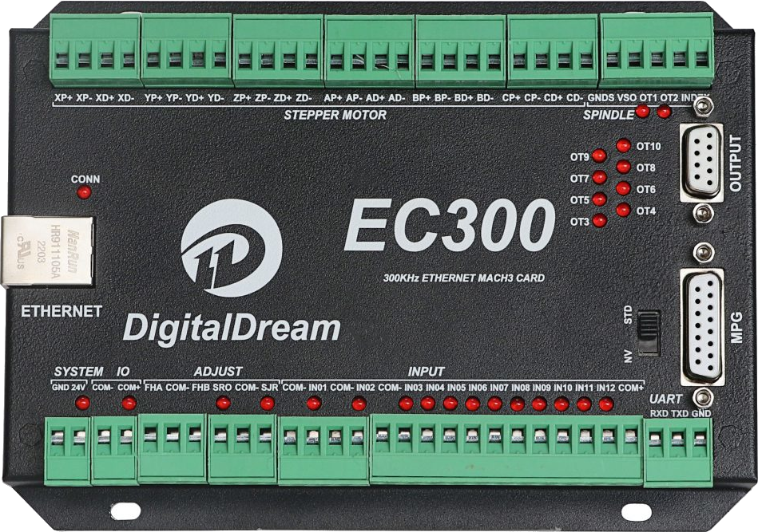

===================
Digital Dream EC300
===================

.. tags:: arch:arm, chip:imxrt, part:imxrt1052, vendor:nxp

The Digital Dream EC300 is a 3 to 6 axis Ethernet CNC motion controller
originally designed to be used with the Mach3 software.  It is based on the
NXP i.MX RT1052 crossover MCU (ARM Cortex-M7).

This port is intended to be the hardware base for running a CNC motion
controller entirely on NuttX.  The pin information used here was taken from
the `Remora-RT1052 <https://github.com/scottalford75/Remora-RT1052-cpp>`_
firmware project (which runs on the EC300, EC500 and NVEM boards) and from
the `EC300 User Manual <https://nvcnc.net/pdf/EC300%20User%20Manual%20V2-nvcnc.pdf>`_.

Features
========

- Processor
    - MIMXRT1052CVL5B, ARM Cortex-M7 at 528 MHz
    - 512 KiB of OCRAM (FlexRAM, no external SDRAM)
- Memory
    - 4 MiB Winbond W25Q32 Quad SPI NOR flash on FlexSPI (XIP boot)
- Connectivity
    - 10/100 Ethernet, Microchip LAN8720A RMII PHY
    - MPG port (Digital Dream NVMPG pendant) on LPUART5
- Motion control I/O (all opto-isolated)
    - 6 step/direction axis outputs (X, Y, Z, A, B, C)
    - 12 general purpose digital inputs
    - 10 general purpose digital outputs
    - 0-10V (or PWM) spindle speed output
- Power
    - 24 VDC main supply, separate 24 VDC IO supply

Supported peripherals
=====================

The initial port supports the serial console, the CONN LED and the Ethernet
interface.  Step generation, digital IO, spindle and MPG drivers will be
added later.

========== ======= =====================================
Peripheral Support NOTES
========== ======= =====================================
LPUART4    Yes     Serial console
ENET       Yes     LAN8720A PHY, RMII, 50 MHz from MCU
GPIO       Yes     CONN LED
LPUART5    No      MPG port, pins already defined
FlexPWM    No      Spindle PWM / step generation
QDC/ENC    No      Encoder inputs
========== ======= =====================================

Serial Console
==============

The NuttX console is on LPUART4 at 115200 8N1:

========== ========== ==========
Function   Pad        Signal
========== ========== ==========
LPUART4_TX GPIO_B1_00 LPUART4_TX
LPUART4_RX GPIO_B1_01 LPUART4_RX
========== ========== ==========

The console is available with RS-232 levels on the bottom right connector
of the EC300, labeled::

    UART
    RXD TXD GND

Connect it to an RS-232 serial port (or a USB to RS-232 adapter): the
connector TXD goes to the PC RXD, the connector RXD goes to the PC TXD and
GND to GND.  Do not connect a 3.3V (TTL) USB-to-serial adapter directly to
this connector.

Ethernet
========

The EC300 uses a LAN8720A RMII PHY.  The i.MX RT generates the 50 MHz RMII
reference clock on ``ENET_REF_CLK`` and feeds it to the PHY.  The PHY uses
MDIO address 0.  It has no reset or interrupt line connected to the MCU.

============= =========== =============
Function      Pad         Signal
============= =========== =============
ENET_RX_DATA0 GPIO_B1_04  ENET_RX_DATA00
ENET_RX_DATA1 GPIO_B1_05  ENET_RX_DATA01
ENET_RX_EN    GPIO_B1_06  ENET_RX_EN
ENET_TX_DATA0 GPIO_B1_07  ENET_TX_DATA00
ENET_TX_DATA1 GPIO_B1_08  ENET_TX_DATA01
ENET_TX_EN    GPIO_B1_09  ENET_TX_EN
ENET_REF_CLK  GPIO_B1_10  ENET_REF_CLK
ENET_RX_ER    GPIO_B1_11  ENET_RX_ER
ENET_MDC      GPIO_B1_14  ENET_MDC
ENET_MDIO     GPIO_B1_15  ENET_MDIO
============= =========== =============

The i.MX RT ENET driver hard-codes MDIO address 1 when
``CONFIG_ETH0_PHY_LAN8720`` is selected.  So the board uses
``CONFIG_ETH0_PHY_MULTI`` and supplies its own PHY description through
``BOARD_ETH0_PHY_LIST`` in ``include/board.h``.

The MAC address comes from the MCU unique ID fuses (OCOTP), so every board
gets a different, stable MAC address.

The PHY interrupt output is not connected to the MCU either.  The board
emulates it by polling (``CONFIG_DDCNC_EC300_PHY_POLL_MSEC``, 1 second by
default), so the PHY notification ioctl (``SIOCMIINOTIFY``) works and the
NETINIT link monitor (``CONFIG_NETINIT_MONITOR``) can detect link changes.
When the cable is plugged in after boot, or unplugged and plugged again, the
interface is brought up again and the PHY renegotiates the link speed.

LEDs
====

There are three LEDs on the front panel: POWER, IO and CONN.  POWER and IO
are driven by hardware.  CONN is connected to ``GPIO_SD_B1_00``
(``GPIO3_IO00``) and is lit when the pin is low.

If ``CONFIG_ARCH_LEDS`` is enabled, NuttX uses the CONN LED to show its
status:

================= ======================= =====
SYMBOL            Meaning                 LED
================= ======================= =====
LED_STARTED       NuttX has been started  OFF
LED_HEAPALLOCATE  Heap has been allocated OFF
LED_IRQSENABLED   Interrupts enabled      OFF
LED_STACKCREATED  Idle stack created      ON
LED_INIRQ         In an interrupt         N/C
LED_SIGNAL        In a signal handler     N/C
LED_ASSERTION     An assertion failed     N/C
LED_PANIC         The system has crashed  FLASH
================= ======================= =====

If the LED is always on, NuttX has booted and is running normally.  If it
flashes at about 2 Hz, a fatal error was detected and the system has halted.

If ``CONFIG_ARCH_LEDS`` is not enabled, the CONN LED can be controlled by
applications with the ``USERLED`` driver.

Motion Control I/O
==================

Remora uses the following MCU GPIOs for the EC300 machine I/O.  No NuttX
drivers use them yet; they are listed here for reference.  All inputs are
active low (opto-isolated).

Step generator outputs:

==== ======== =========
Axis Step     Direction
==== ======== =========
X    GPIO1_22 GPIO1_17
Y    GPIO1_24 GPIO1_31
Z    GPIO1_18 GPIO1_25
A    GPIO1_27 GPIO1_21
B    GPIO1_16 GPIO1_23
C    GPIO1_20 GPIO1_19
==== ======== =========

Digital inputs:

===== ======== ===== ========
Input GPIO     Input GPIO
===== ======== ===== ========
IN01  GPIO4_26 FHA   GPIO3_26
IN02  GPIO4_27 FHB   GPIO4_30
IN03  GPIO4_21 SRO   GPIO3_19
IN04  GPIO4_24 SRJ   GPIO4_20
IN05  GPIO4_28 INDEX GPIO3_22
IN06  GPIO4_25 WHA   GPIO3_16
IN07  GPIO4_29 WHB   GPIO3_17
IN08  GPIO4_23 CIN   GPIO4_18
IN09  GPIO4_31 XIN   GPIO4_17
IN10  GPIO3_18 YIN   GPIO4_16
IN11  GPIO3_21 ZIN   GPIO4_15
IN12  GPIO3_20 AIN   GPIO4_14
===== ======== ===== ========

Digital outputs OT01 to OT10 are on ``GPIO4_02``, ``GPIO4_01``, then
``GPIO4_03`` to ``GPIO4_10``.  The MPG handwheel inputs are X100IN
(``GPIO4_13``), X10IN (``GPIO4_12``) and EP (``GPIO4_11``).

Flashing
========

The EC300 boots from its QSPI NOR flash, a Winbond W25Q32 (JEDEC ID
``0xef4016``).  The NuttX image includes the FlexSPI configuration block,
image vector table and boot data needed by the i.MX RT boot ROM, so the
image is flashed at the start of the flash (``0x60000000``).  The
configurations generate a raw binary (``nuttx.bin``) for this.

The flash is programmed through the SWD port.  OpenOCD has no flash driver
for the i.MX RT FlexSPI controller, so the board provides an OpenOCD
configuration that implements the QSPI NOR erase, program, verify and read
operations as Tcl commands:
``boards/arm/imxrt/ddcnc-ec300/tools/ddcnc-ec300.cfg``.  It has been tested
with OpenOCD 0.12.0 and an ST-Link/V2 probe; other probes can be selected
by setting ``INTERFACE`` (e.g. ``-c "set INTERFACE cmsis-dap"``).

.. warning::

   Flashing NuttX erases the original Mach3 firmware.  Make a backup of the
   flash first, so it can be restored later.

Backup the whole 4 MiB flash::

    $ openocd -f boards/arm/imxrt/ddcnc-ec300/tools/ddcnc-ec300.cfg \
        -c "init; ec300_flash_dump ec300-original.bin; reset run; shutdown"

Program NuttX, verify it and reboot the board::

    $ openocd -f boards/arm/imxrt/ddcnc-ec300/tools/ddcnc-ec300.cfg \
        -c "init; ec300_program nuttx.bin; shutdown"

Restore the original firmware from the backup::

    $ openocd -f boards/arm/imxrt/ddcnc-ec300/tools/ddcnc-ec300.cfg \
        -c "init; ec300_program ec300-original.bin; shutdown"

Other commands provided by the configuration (run them after ``init``):

=================================== ====================================
Command                             Description
=================================== ====================================
``ec300_flash_info``                Show the JEDEC ID and status registers
``ec300_flash_erase <off> <len>``   Erase a range (4 KiB sectors)
``ec300_flash_erase_all``           Erase the whole flash
``ec300_flash_write <file> [off]``  Program a raw binary file
``ec300_flash_verify <file> [off]`` Compare the flash with a binary file
``ec300_flash_dump <file> [off]``   Read the flash into a file
=================================== ====================================

Programming runs at about 7 KiB/s with an ST-Link/V2, so a NuttX image
takes around 25 seconds.

Configurations
==============

Each configuration is set up and built like this::

    $ ./tools/configure.sh ddcnc-ec300:<subdir>
    $ make

Where ``<subdir>`` is one of the following:

nsh
---

A basic NuttShell (NSH) configuration on the LPUART4 serial console.

netnsh
------

Same as ``nsh``, plus Ethernet networking with TCP, UDP, ICMP (ping) and
the Telnet daemon.  The network is initialized in a background thread that
keeps monitoring the link state, so the Ethernet cable can be connected
after the board has booted.  The board uses a static IPv4 address that matches the
Remora / LinuxCNC defaults:

=========== ===========
Setting     Value
=========== ===========
IP address  10.10.10.10
Netmask     255.255.255.0
Gateway     10.10.10.1
=========== ===========

To test it, set the host's Ethernet interface to an address in the
``10.10.10.x`` network, then::

    $ ping 10.10.10.10
    $ telnet 10.10.10.10

On the board you can check the interface with::

    nsh> ifconfig
    nsh> ping 10.10.10.1
