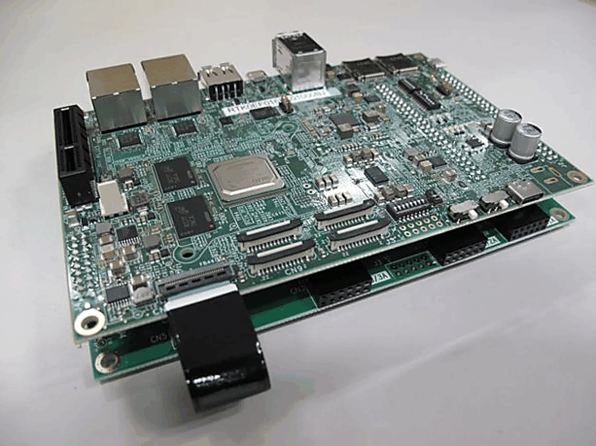

=========
RZV2H-EVK
=========

.. tags:: arch:arm, arch:armv7-r, arch:cortex-r8, chip:rzv2h, vendor:renesas

The RZV2H-EVK is an evaluation board for the Renesas RZ/V2H (R9A09G057)
MPU. NuttX is ported to run on one of the two Cortex-R8 real-time cores
(``CR8_0``).

Board Overview
===============

See the `RZ/V2H product page
<https://www.renesas.com/en/design-resources/boards-kits/rz-v2h-evk#overview>`_
for information about the RZ/V2H MPU.

Board Set-up
============

.. figure:: rzv2h-evk-board-set-up.png
   :align: center
   :width: 500px

The following steps set up the board to debug/run NuttX over SWD with a
J-Link debugger:

1. Configure the SWD interface to use the J-Link debugger via the DIP
   switches (highlighted in red in the picture above):

   =====  ===  =====  ===
   DSW 1  Set  DSW 2  Set
   =====  ===  =====  ===
   1-1    ON   2-1    OFF
   1-2    OFF  2-2    OFF
   1-3    ON   2-3    OFF
   1-4    OFF  2-4    OFF
   1-5    ON   2-5    OFF
   1-6    OFF  2-6    OFF
   1-7    ON
   1-8    OFF
   =====  ===  =====  ===

2. Connect CN1 to the J-Link debugger.

3. Make sure SW2 and SW3 are OFF before connecting CN13 to the power
   supply.

4. After CN13 is connected to the power supply, turn SW3 ON first, then
   turn SW2 ON.

To power off the board, reverse the order: disconnect the J-Link debugger
first, then turn SW2 OFF, then SW3 OFF, and only then remove power.

Getting the HAL Renesas
=======================

Clock bring-up (see below) is implemented on top of Renesas' vendored FSP
BSP code, which ships in a separate ``hal_renesas`` repository and is
**not** part of the ``nuttx`` git tree.

``make context`` (run automatically as part of a normal build) clones the
repository at the pinned version into
``arch/arm/src/common/renesas/hal_renesas``, as defined in
``arch/arm/src/common/renesas/Make.defs``. Nothing needs to be cloned
manually. ``make distclean`` removes it.

``HAL_RENESAS_URL`` and ``HAL_RENESAS_VERSION`` can be set in the
environment to use another repository or revision, for example a local
checkout:

.. code-block:: bash

   HAL_RENESAS_URL=/path/to/hal_renesas make

Buttons and LEDs
================

Buttons
-------

The RZ/V2H-EVK has no dedicated user button.  The board port reserves
``P8_2`` for one external, active-high button and exposes it through the
generic NuttX GPIO interface as ``/dev/gpio0``.  It does not currently
provide a discrete NuttX button device such as ``/dev/buttons``.

Hardware connection
~~~~~~~~~~~~~~~~~~~

Locate ``P8_2`` on the selected expansion connector using the RZ/V2H-EVK
schematic.  Connect a normally-open momentary switch between ``P8_2`` and
the board's 3.3-V logic supply, with a common ground between the board and
the external circuit.  The board configures ``P8_2`` as an input with its
internal pull-down enabled:

* button released: the pull-down drives the input low; ``/dev/gpio0`` reads
  ``0``;
* button pressed: the switch drives the input high; ``/dev/gpio0`` reads
  ``1``.

The pin definition is ``BOARD_P8_2_BUTTON`` in
``boards/arm/rzv2h/rzv2h-evk/include/board.h``.  It selects
``BSP_IO_PORT_08_PIN_02`` with input, input-buffer, and pull-down settings.

.. warning::

   ``P8_2`` is a multiplexed pin.  Confirm the EVK schematic and make sure
   that no enabled peripheral claims this pin before connecting the button.

Configuration and registration
~~~~~~~~~~~~~~~~~~~~~~~~~~~~~~

Use a configuration that enables the generic GPIO test path, for example
``rzv2h-evk:nsh-leds``.  The required options are::

   CONFIG_DEV_GPIO=y
   CONFIG_RZV2H_GPIO=y
   CONFIG_EXAMPLES_GPIO=y
   CONFIG_BOARD_LATE_INITIALIZE=y

During ``board_late_initialize()``, ``rzv2h_bringup()`` calls
``rzv2h_gpio_initialize()``.  This registers the one input first as
``/dev/gpio0`` and configures the input through the Renesas FSP IOPORT
driver.  ``CONFIG_RZV2H_GPIO`` defaults to enabled when ``CONFIG_DEV_GPIO``
is selected, but it is shown above to make the dependency explicit.

NSH usage example
~~~~~~~~~~~~~~~~~

After booting NuttX, first verify that the device was registered::

   nsh> ls /dev
   nsh> gpio /dev/gpio0
   Driver: /dev/gpio0
     Input pin:     Value=0

Press and hold the button, then run the read command again::

   nsh> gpio /dev/gpio0
   Driver: /dev/gpio0
     Input pin:     Value=1

Release the button and repeat the command; the value must return to ``0``.
Each invocation of the standard ``apps/examples/gpio`` application performs
one read and exits, so the button must remain pressed for the second command.

Current limitations
~~~~~~~~~~~~~~~~~~~

The current GPIO implementation supports synchronous read and write only.
GPIO interrupt attachment and enablement are placeholders, so ``gpio -w``
cannot report button transitions.  Runtime pin-type changes are also not
implemented, so do not use ``gpio -t``.  The board does not debounce the
external switch; use a polling application with software debounce if
continuous monitoring is required.

LEDs
----

Two active-low GPIO outputs are available for LED testing.  They are
registered after the button input, giving the following device mapping:

.. list-table::
   :header-rows: 1

   * - Pin
     - GPIO device
     - Function
   * - ``P0_0``
     - ``/dev/gpio1``
     - LED output 1
   * - ``P0_1``
     - ``/dev/gpio2``
     - LED output 2

Using the NSH GPIO application
~~~~~~~~~~~~~~~~~~~~~~~~~~~~~~

The ``nsh`` configuration enables ``CONFIG_DEV_GPIO`` and
``CONFIG_EXAMPLES_GPIO``.  The ``gpio`` example is reused from the standard
NuttX application repository at ``apps/examples/gpio``; it is not an
RZ/V2H-specific application.  The RZ/V2H board port only configures the pins,
registers ``/dev/gpio0`` through ``/dev/gpio2``, and enables the example in
the board configuration.  The upstream example source is used without
board-specific polling logic.

The GPIO application uses the following command format::

   gpio [-t <pintype>] [-w <signo>] [-o <value>] <driver-path>

.. note::

   At this stage, the RZ/V2H GPIO driver supports only GPIO read and write
   operations for application testing.  Changing the pin type is not
   supported: ``GPIOC_SETPINTYPE`` does not reconfigure the hardware.
   GPIO interrupt attachment and enablement are also placeholders, so
   interrupt notification is not available.

   Consequently, use only ``gpio <driver-path>`` for reading and
   ``gpio -o <0|1> <driver-path>`` for writing.  Do not use the ``-t``
   pin-type option or the ``-w`` interrupt-wait option on this board.

For these LED outputs, only ``-o`` and the device path are needed.  The
``-o`` option writes the logical pin level (zero or one), while the device
path selects the LED.  Because the LEDs are active low, write zero to turn an
LED on and one to turn it off.  For example::

   nsh> gpio -o 0 /dev/gpio1
   nsh> gpio -o 1 /dev/gpio1
   nsh> gpio -o 0 /dev/gpio2
   nsh> gpio -o 1 /dev/gpio2

For each command, the application reports the previous output level, the
level being written, and the level read back from the driver.  For example,
if LED output 1 is currently off::

   nsh> gpio -o 0 /dev/gpio1
   Driver: /dev/gpio1
     Output pin:    Value=1
     Writing:       Value=0
     Verify:        Value=0

Omit ``-o`` to read the current output level without changing it::

   nsh> gpio /dev/gpio1

Each invocation performs a single GPIO operation and then exits.  This is
sufficient for the manual button and LED validation described here.

Use ``gpio -h`` to display the generic application's command syntax.  Some
options shown by that help text are not yet supported by the RZ/V2H GPIO
driver, as described above.

Using the NuttX user-LED application
~~~~~~~~~~~~~~~~~~~~~~~~~~~~~~~~~~~~

The ``nsh-leds`` configuration also enables the standard NuttX user-LED
interface and example with these options::

   # CONFIG_ARCH_LEDS is not set
   CONFIG_USERLED=y
   CONFIG_USERLED_LOWER=y
   CONFIG_EXAMPLES_LEDS=y
   CONFIG_BOARD_LATE_INITIALIZE=y

During late initialization, the board registers ``/dev/userleds``.  The
``board_userled_*()`` callbacks configure ``P0_0`` and ``P0_1``, convert the
logical LED state to the active-low pin level, and support LED mask bits
``0x01`` and ``0x02``.

Run the unmodified NuttX example from ``apps/examples/leds`` to cycle the two
LED outputs::

   nsh> ls /dev
   nsh> leds

The device list should contain ``userleds``, and the example should report a
supported LED mask of ``0x03``.  The ``leds`` command starts a background
``led_daemon`` that cycles the LED mask.  Its startup message prints the
daemon PID; use ``kill <pid>`` to stop it.

This interface is separate from the generic ``/dev/gpio1`` and
``/dev/gpio2`` devices.  Use the ``gpio`` example for individual read/write
validation, or use the ``leds`` example to exercise the NuttX user-LED API.
Automatic OS-status LED control through ``CONFIG_ARCH_LEDS`` is not yet
implemented.

Application test responsibilities
~~~~~~~~~~~~~~~~~~~~~~~~~~~~~~~~~

The current button and LED tests both reuse the standard NuttX GPIO example:

.. list-table::
   :header-rows: 1

   * - Test
     - Application source
     - Responsibility
   * - Button read test
     - Standard NuttX ``apps/examples/gpio`` application
     - Press and hold the button, then read ``/dev/gpio0``
   * - LED read/write test
     - Standard NuttX ``apps/examples/gpio`` application
     - Reused unchanged; the board port only configures and registers the
       LED GPIO devices
   * - User-LED sequence test
     - Standard NuttX ``apps/examples/leds`` application
     - Reused unchanged; it controls both active-low outputs through
       ``/dev/userleds``

.. important::

   No RZ/V2H-specific test application is required for the current manual
   validation.  Use the standard NuttX ``gpio`` example to read the button
   through ``/dev/gpio0`` and to control the LEDs through ``/dev/gpio1`` and
   ``/dev/gpio2``.  A separate polling application is needed only if
   continuous monitoring, transition detection, or debounce testing is
   required later.

   The GPIO devices are registered from the board late-initialization path, so
   ``CONFIG_BOARD_LATE_INITIALIZE`` must remain enabled.

   The user-controlled ``board_userled_*()`` hooks and ``/dev/userleds`` are
   supported.  The automatic ``board_autoled_*()`` hooks selected by
   ``CONFIG_ARCH_LEDS`` remain placeholders.

Serial Consoles
===============

The default ``nsh`` configuration uses SCI channel 0 as the serial console
at 115200 baud, 8 data bits, no parity, and one stop bit. The board pin
definitions route SCI0 as follows:

======  ========  =======================
Signal  Pin       Board definition
======  ========  =======================
TXD0    ``P5_0``  ``BOARD_SCI0_TXD_GPIO``
RXD0    ``P5_1``  ``BOARD_SCI0_RXD_GPIO``
======  ========  =======================

Connect the USB-to-UART adapter to the CN3 Pmod contacts shown below:

========  ==========  ========  =========================
CN3 pin   CN3 signal  SoC pin   USB-to-UART connection
========  ==========  ========  =========================
1         CTS         ``P52``   RTS (Unused)
2         TXD0        ``P50``   RX
3         RXD0        ``P51``   TX
4         RTS         ``P53``   CTS (Unused)
5         GND         --        GND
6         VCC         --        VCC
7         IO1         ``P57``   Unused
8         IO2         ``P73``   Unused
9         IO3         ``P76``   Unused
10        IO4         ``P77``   Unused
11        GND         --        Unused
12        VCC         --        Unused
========  ==========  ========  =========================

Cross the data lines so that CN3 TXD0 connects to the adapter RX and CN3
RXD0 connects to the adapter TX. Hardware flow control is not enabled, so
CTS and RTS remain disconnected. Use a 3.3 V TTL UART adapter, not an RS-232
adapter. The table assumes that the adapter is powered through USB; do not
connect either CN3 VCC contact to the adapter.

The relevant default options are::

   CONFIG_RZV2H_UART_SCI=y
   CONFIG_RZV2H_SCI_B_UART0=y
   CONFIG_SCI0_SERIAL_CONSOLE=y
   CONFIG_SCI0_BAUD=115200
   CONFIG_SCI0_BITS=8
   CONFIG_SCI0_PARITY=0
   CONFIG_SCI0_2STOP=0

After boot, SCI0 is available as both ``/dev/console`` and ``/dev/ttyS0``.
The terminal should display the NuttX banner followed by the ``nsh>`` prompt.
Verify the registration with::

   nsh> ls /dev
   /dev:
    console
    null
    ttyS0
    zero

Additional enabled SCI channels are registered as later ``/dev/ttyS*``
devices in ascending hardware-channel order. Their TX and RX pin choices are
board-specific and are defined by ``BOARD_SCIn_TXD_GPIO`` and
``BOARD_SCIn_RXD_GPIO`` in ``boards/arm/rzv2h/rzv2h-evk/include/board.h``.

RIIC I2C
========

The RZV2H-EVK exposes nine RIIC I2C master channels (RIIC0-RIIC8).

RIIC Pin Assignments
--------------------

Each RIIC channel is routed to the following board pins.

.. list-table::
   :header-rows: 1

   * - Channel
     - SCL Pin
     - SDA Pin
   * - RIIC0
     - ``P3_1``
     - ``P3_0``
   * - RIIC1
     - ``P3_3``
     - ``P3_2``
   * - RIIC2
     - ``P2_1``
     - ``P2_0``
   * - RIIC3
     - ``P3_7``
     - ``P3_6``
   * - RIIC4
     - ``P4_1``
     - ``P4_0``
   * - RIIC5
     - ``P4_3``
     - ``P4_2``
   * - RIIC6
     - ``P4_5``
     - ``P4_4``
   * - RIIC7
     - ``P4_7``
     - ``P4_6``
   * - RIIC8
     - ``P0_7``
     - ``P0_6``

These definitions are in ``boards/arm/rzv2h/rzv2h-evk/include/board.h``.

Default Interrupt Select IDs
-----------------------------

Each RIIC channel uses eight interrupt sources. TXI and RXI are routed
through the programmable INTC interrupt-select (SEL) lines; the remaining
six (TEI, NAKI, SPI, STI, ALI, TMOI) are fixed GIC interrupts.

**TXI / RXI SEL IRQ numbers** (configurable via Kconfig, valid range
353-479):

.. list-table::
   :header-rows: 1

   * - Channel
     - TXI SEL (GIC IRQ)
     - RXI SEL (GIC IRQ)
   * - RIIC0
     - 447 (SEL94)
     - 446 (SEL93)
   * - RIIC1
     - 445 (SEL92)
     - 444 (SEL91)
   * - RIIC2
     - 443 (SEL90)
     - 442 (SEL89)
   * - RIIC3
     - 441 (SEL88)
     - 440 (SEL87)
   * - RIIC4
     - 439 (SEL86)
     - 438 (SEL85)
   * - RIIC5
     - 437 (SEL84)
     - 436 (SEL83)
   * - RIIC6
     - 435 (SEL82)
     - 434 (SEL81)
   * - RIIC7
     - 433 (SEL80)
     - 432 (SEL79)
   * - RIIC8
     - 431 (SEL78)
     - 430 (SEL77)

The relevant options for enabling RIIC2 as an example are::

   CONFIG_I2C=y
   CONFIG_RZV2H_RIIC_I2C=y
   CONFIG_RZV2H_RIIC2=y
   CONFIG_I2C_RESET=y
   CONFIG_SYSTEM_I2CTOOL=y

Each channel has additional Kconfig options for bitrate, SCL rise/fall
times, duty cycle, noise filter stages, TXI/RXI interrupt-select (SEL) IRQ
numbers, and interrupt priority.

After boot, enabled RIIC I2C channels are registered as ``/dev/i2cN``
devices.
Verify with::

   nsh> ls /dev
   /dev:
    console
    i2c2
    null
    zero

The ``riic-i2c`` board configuration (``rzv2h-evk:riic-i2c``) enables
RIIC2 and the ``i2ctool`` application for interactive testing. Other
channels can be enabled by adding the corresponding ``CONFIG_RZV2H_RIICn``
options.

Using the ``i2ctool`` Application with RIIC
-------------------------------------------

Scan for devices on bus 2 from address 0x00 to 0x20::

   nsh> i2c dev -b 2 0 0x20

Get the register at address 0x2D from a device at address 0x1D on bus 2::

   nsh> i2c get -b 2 -a 0x1D -r 0x2D

Set value 0x08 to the register at address 0x2D of a device at address 0x1D
on bus 2::

   nsh> i2c set -b 2 -a 0x1D -r 0x2D 0x08

Dump 6 consecutive bytes starting at register address 0x32 from a device at
address 0x1D on bus 2::

   nsh> i2c dump -b 2 -a 0x1D -r 0x32 6

SCI I2C
=======

The SCI channels listed below can run as I2C masters in simple I2C mode,
provided that the channel's SCI UART is disabled. SCI channel ``n`` is
registered as ``/dev/i2c<CONFIG_RZV2H_SCI_I2C_BUS_OFFSET + n>``. The
default offset is 10, so the SCI I2C buses do not overlap the RIIC I2C
buses.

SCI I2C Pin Assignments
-----------------------

SDA uses the TXDn pin and SCL uses the RXDn pin of each SCI channel.

.. list-table::
   :header-rows: 1

   * - Channel
     - SDA Pin
     - SCL Pin
   * - SCI0
     - ``P5_0``
     - ``P5_1``
   * - SCI1
     - ``P5_2``
     - ``P5_3``
   * - SCI2
     - ``P5_4``
     - ``P5_5``
   * - SCI4
     - ``P8_4``
     - ``P8_5``
   * - SCI5
     - ``P7_2``
     - ``P7_3``
   * - SCI6
     - ``P7_4``
     - ``P7_5``
   * - SCI7
     - ``P7_6``
     - ``P7_7``
   * - SCI8
     - ``P8_0``
     - ``P8_1``
   * - SCI9
     - ``P8_2``
     - ``P8_3``

Configuration
-------------

The relevant options for enabling SCI7 as an example are::

   CONFIG_I2C=y
   CONFIG_RZV2H_SCI_I2C=y
   CONFIG_RZV2H_SCI_I2C7=y
   CONFIG_I2C_RESET=y
   CONFIG_SYSTEM_I2CTOOL=y
   CONFIG_I2CTOOL_MAXBUS=19

``CONFIG_I2CTOOL_MAXBUS`` must be at least
``CONFIG_RZV2H_SCI_I2C_BUS_OFFSET`` plus the SCI channel number, or
``i2ctool`` rejects the bus number.

Each channel has additional Kconfig options for bit rate, SDA output delay,
noise filter clock, bit-rate modulation, and interrupt priority. TXI and
TEI are fixed GIC interrupts, so SCI I2C has no interrupt-select (SEL)
options.

After boot, verify that the channel is registered::

   nsh> ls /dev
   /dev:
    ...
    i2c17
    ...

Using the ``i2ctool`` Application with SCI I2C
----------------------------------------------

The ``sci-i2c`` board configuration (``rzv2h-evk:sci-i2c``) enables
SCI7 and the ``i2ctool`` application. Use the same ``i2c`` commands as for
RIIC I2C, with the SCI I2C bus number::

   nsh> i2c bus
   nsh> i2c dev -b 17 0x03 0x77
   nsh> i2c get -b 17 -a 0x50 -r 0x00
   nsh> i2c set -b 17 -a 0x50 -r 0x10 0x5a
   nsh> i2c reset -b 17

PWM
===

The RZV2H-EVK exposes GPT-based PWM output on channels 0 through 15.

Pin Assignments
---------------

Each GPT channel is routed to the following board pin.

.. list-table::
   :header-rows: 1

   * - Channel
     - Pin
   * - GPT0
     - ``P7_0``
   * - GPT1
     - ``P8_0``
   * - GPT2
     - ``P4_4``
   * - GPT3
     - ``P4_6``
   * - GPT4
     - ``P9_4``
   * - GPT5
     - ``P9_6``
   * - GPT6
     - ``P3_4``
   * - GPT7
     - ``P8_6``
   * - GPT8
     - ``P9_4``
   * - GPT9
     - ``P9_6``
   * - GPT10
     - ``PA_4``
   * - GPT11
     - ``P6_2``
   * - GPT12
     - ``P3_0``
   * - GPT13
     - ``P6_4``
   * - GPT14
     - ``P3_5``
   * - GPT15
     - ``P6_6``

These definitions are in ``boards/arm/rzv2h/rzv2h-evk/include/board.h``.

The relevant options for enabling GPT7 as an example are::

   CONFIG_PWM=y
   CONFIG_RZV2H_GPT_PWM=y
   CONFIG_RZV2H_GPT7_PWM=y
   CONFIG_RZV2H_GPT_PWM_DEFAULT_FREQUENCY=1000
   CONFIG_EXAMPLES_PWM=y

After boot, enabled PWM channels are registered as ``/dev/pwmN`` devices.
Verify with::

   nsh> ls /dev
   /dev:
    console
    null
    pwm7
    ttyS0
    zero

The ``pwm`` board configuration (``rzv2h-evk:pwm``) enables GPT7
(PWM output on P8_6, corresponding to CN1 Pmod pin 9) and the
``pwm`` application for interactive testing. Other channels can be
enabled by adding the corresponding ``CONFIG_RZV2H_GPTn_PWM`` options.

Using the ``pwm`` Application
-----------------------------

Start a 1 Hz PWM signal at 50% duty cycle on channel 7::

   nsh> pwm -p /dev/pwm7 -f 1 -d 50

The ``-f`` option sets the frequency in Hz and ``-d`` sets the duty cycle.

CAN
===

The RZV2H-EVK board port defines pins for six CAN-FD channels
(CANFD0-CANFD5).

CAN Pin Assignments
-------------------

Each CAN-FD channel is routed to the following board pins.

.. list-table::
   :header-rows: 1

   * - Channel
     - TX Pin
     - RX Pin
   * - CANFD0
     - ``P8_0``
     - ``P8_1``
   * - CANFD1
     - ``P8_2``
     - ``P8_3``
   * - CANFD2
     - ``P8_4``
     - ``P8_5``
   * - CANFD3
     - ``P8_6``
     - ``P8_7``
   * - CANFD4
     - ``P4_2``
     - ``P4_3``
   * - CANFD5
     - ``P4_6``
     - ``P4_7``

These definitions are in ``boards/arm/rzv2h/rzv2h-evk/include/board.h``.

CAN Default Interrupt Select IDs
--------------------------------

All CAN-FD interrupts are routed through the programmable INTC
interrupt-select (SEL) lines. Each channel uses three: REC (reception
into a Common FIFO), TRX (transmit complete or abort) and ERR (channel
error). Two more lines are shared by all channels: GERR (global error)
and GRECC (reception into an RX FIFO).

**SEL IRQ numbers** (configurable via Kconfig, valid range 353-479):

.. list-table::
   :header-rows: 1

   * - Channel
     - REC SEL (GIC IRQ)
     - TRX SEL (GIC IRQ)
     - ERR SEL (GIC IRQ)
   * - CANFD0
     - 417 (SEL64)
     - 416 (SEL63)
     - 415 (SEL62)
   * - CANFD1
     - 414 (SEL61)
     - 413 (SEL60)
     - 412 (SEL59)
   * - CANFD2
     - 411 (SEL58)
     - 410 (SEL57)
     - 409 (SEL56)
   * - CANFD3
     - 408 (SEL55)
     - 407 (SEL54)
     - 406 (SEL53)
   * - CANFD4
     - 405 (SEL52)
     - 404 (SEL51)
     - 403 (SEL50)
   * - CANFD5
     - 402 (SEL49)
     - 401 (SEL48)
     - 400 (SEL47)

The shared lines default to 419 (SEL66) for GERR
(``CONFIG_RZV2H_CANFD_GERR_INTSEL``) and 418 (SEL65) for GRECC
(``CONFIG_RZV2H_CANFD_GREEC_INTSEL``).

The relevant options for enabling CANFD0 in external loopback mode, as in
the ``can-loopback`` configuration, are::

   CONFIG_CAN=y
   CONFIG_CAN_EXTID=y
   CONFIG_CAN_FD=y
   CONFIG_CAN_ERRORS=y
   CONFIG_CAN_LOOPBACK=y
   CONFIG_RZV2H_CANFD=y
   CONFIG_RZV2H_CANFD_LOOPBACK_EXTERNAL=y
   CONFIG_RZV2H_CANFD0=y
   CONFIG_RZV2H_CANFD_RXFIFO0_ENABLED=y
   CONFIG_EXAMPLES_CAN=y
   CONFIG_EXAMPLES_CAN_NMSGS=100

By default channel n receives in RX FIFO n, so RX FIFO n must be enabled
(``CONFIG_RZV2H_CANFD_RXFIFOn_ENABLED``) for each enabled channel. Each
channel has additional Kconfig options for bit rates, receive FIFO, TX
message buffers, error interrupts, REC/TRX/ERR interrupt-select (SEL) IRQ
numbers, and interrupt priority.

After boot, enabled CAN-FD channels are registered as ``/dev/canX``
devices, where X is the channel number. Verify with ``ls /dev`` that
``can0`` is listed.

The ``can-loopback`` board configuration (``rzv2h-evk:can-loopback``)
enables CANFD0 in external loopback mode and the ``can`` example. Other
channels can be enabled by adding the corresponding
``CONFIG_RZV2H_CANFDn`` options.

Using the ``can`` Application
-----------------------------

In the ``can-loopback`` configuration CANFD0 runs in external loopback
mode: it receives its own frames back through the CAN transceiver and
sends its own acknowledge, so no other node is needed on the bus. CANFD0
TX and RX (``P8_0`` and ``P8_1``) must be connected to a powered CAN
transceiver.

Send and check 100 frames (``CONFIG_EXAMPLES_CAN_NMSGS``)::

   nsh> can

Send and check 20 frames::

   nsh> can -n 20

Use standard IDs instead of extended IDs::

   nsh> can -s

Send CAN FD frames without bit rate switching::

   nsh> can -e

Each frame is printed when it is sent, then again with ``-- OK`` when the
frame read back matches it.

SocketCAN
---------

With ``CONFIG_RZV2H_CANFD_SOCKET`` (CAN-FD option "CAN character driver or
SocketCAN support"), channel n is the SocketCAN network interface
``can<n>`` instead of ``/dev/can<n>``.
The ``can-socketcan`` board configuration (``rzv2h-evk:can-socketcan``)
enables CANFD0 (``can0``) and CANFD1 (``can1``) with the ``candump`` and
``cansend`` tools. With the transceivers of CANFD0 and CANFD1 on the same
bus, then::

   nsh> ifup can0
   nsh> ifup can1
   nsh> candump can1 &
   nsh> cansend can0 123#DEADBEEF
   nsh> cansend can0 12345678#1122
   nsh> cansend can0 456##1DEADBEEF

The last command sends a CAN FD frame with bit rate switching. Bit rates
(``SIOCSCANBITRATE``, while the interface is down), filters
(``SIOCACANSTDFILTER``, ``SIOCACANEXTFILTER``) and bus-off recovery
(``SIOCCANRECOVERY``) are set with ioctl() on a CAN socket.

DroneCAN
--------

The ``can-dronecan`` board configuration (``rzv2h-evk:can-dronecan``)
enables CANFD0 (``/dev/can0``) and CANFD1 (``/dev/can1``) with the
``dronecan`` example. With the transceivers of CANFD0 and CANFD1 on the
same bus, listen on ``/dev/can1`` and start the example::

   nsh> hexdump /dev/can1 &
   nsh> dronecan

OpenCyphal
----------

The ``can-opencyphal`` board configuration (``rzv2h-evk:can-opencyphal``)
enables CANFD0 (``can0``) and CANFD1 (``can1``) with the ``opencyphal``
example and the ``candump`` and ``cansend`` tools. With the transceivers
of CANFD0 and CANFD1 on the same bus, bring up both interfaces, listen on
``can1`` and start the example::

   nsh> ifup can0
   nsh> ifup can1
   nsh> candump can1 &
   nsh> opencyphal

SLCAN
-----

The ``can-slcan`` board configuration (``rzv2h-evk:can-slcan``) enables
CANFD0 (``can0``), CANFD1 (``can1``) and SCI1 (``/dev/ttyS1``, TXD1 on
``P5_2``, RXD1 on ``P5_3``) with the ``slcan`` tool, which bridges a CAN
interface to a serial line using the SLCAN protocol. Put the transceivers
of CANFD0 and CANFD1 on the same bus, and connect a host serial terminal
to SCI1. Bridge ``can1`` to ``/dev/ttyS1`` and listen on ``can0``, both in
the background::

   nsh> ifup can0
   nsh> ifup can1
   nsh> slcan can1 /dev/ttyS1 &
   nsh> candump can0 &

On the terminal, send ``O`` to open the channel so ``slcan`` accepts send
commands. Frames typed after that are sent on ``can1``. ``t`` sends a
standard ID frame and ``T`` an extended ID frame, each followed by the ID
(3 or 8 hex digits), the data length and the data bytes::

   O
   t7FF3010299
   t1238DEADBEEF11223344

``candump`` shows each frame received on ``can0``::

   can0  7FF   [3]  01 02 99
   can0  123   [8]  DE AD BE EF 11 22 33 44

QSPI Flash
==========

The board port drives the xSPI controller in QSPI mode (see
:doc:`the RZV2H peripheral overview <../../index>`) to talk to a SPI NOR
flash device. There is no flash part wired into the NuttX tree for this
board; select the matching ``CONFIG_MTD_*`` driver for the part actually
fitted on the EVK before enabling ``CONFIG_RZV2H_QSPI``.

``rzv2h_qspi_initialize()``
(``boards/arm/rzv2h/rzv2h-evk/src/rzv2h_qspi.c``) brings up the bus,
initializes the selected MTD flash driver, and then either:

- mounts the whole chip as a single flat LittleFS volume at ``/mnt/qspi``
  (default), or
- if ``CONFIG_MTD_PARTITION`` is enabled, splits the chip into three MTD
  partitions first (see Partitioning below), and mounts LittleFS on the
  remaining space only.

Read protocol
-------------

The default read protocol is ``1S-4S-4S``. ``1S-1S-1S``, ``1S-2S-2S``,
and ``4S-4S-4S`` also work on this board. They are selected with the
``CONFIG_RZV2H_EVK_QSPI_N25QXXX_PROTOCOL_*`` choice (see
:doc:`the RZV2H peripheral overview <../../index>`).

This board ties ``XSPI0_DS`` to GND through a 10K resistor (R47). It
also leaves ``XSPI0_IO4``-``XSPI0_IO7`` unconnected to the flash. As a
result, the DDR protocols cannot work here:

- Selecting ``CONFIG_RZV2H_EVK_QSPI_N25QXXX_PROTOCOL_4S4D4D`` stops the build
  with an ``#error``.
- ``8D-8D-8D`` is not supported.

Partitioning
------------

Enabling ``CONFIG_MTD_PARTITION`` (plus ``CONFIG_MTD_CONFIG`` or
``CONFIG_MTD_CONFIG_NVS``) makes ``rzv2h_qspi_partition()`` divide
the flash chip into three independent regions, so that firmware,
parameters, and logging cannot corrupt one another on the same chip:

.. list-table::
   :header-rows: 1

   * - Partition
     - Size (Kconfig)
     - Exposed as
     - Purpose
   * - Firmware image
     - ``CONFIG_RZV2H_EVK_QSPI_FW_PART_SIZE`` (KiB, default 4096)
     - ``/dev/mtdfw0`` (raw MTD, no filesystem)
     - Fixed-offset region for a flight-stack (e.g. PX4) firmware image,
       read/written directly by a bootloader/loader
   * - Parameter/configuration
     - ``CONFIG_RZV2H_EVK_QSPI_PARAM_PART_SIZE`` (KiB, default 256)
     - ``/dev/config`` (via ``mtdconfig_register()``)
     - Key/value parameter and configuration store, isolated from
       filesystem I/O
   * - Mission data / flight logs
     - remainder of the chip
     - ``/mnt/qspi`` (LittleFS)
     - Ordinary files: mission data, flight logs, and (optionally) the
       redirected syslog file described below

Both partition sizes are rounded down to a multiple of the flash erase
size. If the requested firmware and parameter partitions do not fit
within the chip's erase-block count, ``rzv2h_qspi_initialize()``
fails with an error logged via ``syslog()``.

When ``CONFIG_MTD_PARTITION`` is disabled, none of the above applies and
the chip is used as a single flat LittleFS volume, as before.

Persistent syslog
------------------

``CONFIG_RZV2H_EVK_QSPI_SYSLOG_FILE`` redirects kernel ``syslog()`` output to
a file on the mounted QSPI LittleFS volume (default path
``/mnt/qspi/syslog.txt``, set via ``CONFIG_RZV2H_EVK_QSPI_SYSLOG_FILE_PATH``)
once it is mounted, so log messages persist across resets. This requires
``CONFIG_FS_LITTLEFS`` and ``CONFIG_SYSLOG_FILE``. When
``CONFIG_MTD_PARTITION`` is enabled, this file lives in the mission-data
/ flight-log partition described above, not in the firmware or parameter
partitions.

Bring-up
========

This section describes what has been brought up so far for the CR8_0 core.
Clock, MPU, GIC, timer, GPIO, and SCI-B UART support described on this
page are implemented.  Board options not described here may still be
placeholders.

Clock control
-------------

``rzv2h_clockconfig()`` (``arch/arm/src/rzv2h/rzv2h_clockconfig.c``) calls
into ``bsp_clock_init()`` from the vendored Renesas FSP BSP
(``arch/arm/src/common/renesas/hal_renesas/...``), which programs the PLL and clock
tree. The system tick timer (see Timer below) derives its input clock from
the resulting ``BSP_CFG_CLOCK_I6CLK_HZ`` value, so this must run before the
timer is configured.

MPU enablement
--------------

``arch/arm/src/rzv2h/rzv2h_mpu_region.c`` defines a static PMSAv7 region
table (``g_mpu_region_table[]``) for CR8 core 0:

- Region 0 - ITCM (0x00000000, 128 KB), read-only, holds the exception
  vector table copied there by ``arm_boot()``.
- Region 1 - DTCM (0x00020000, 128 KB), read/write, execute-never.
- Region 2 - RCPU-SRAM (cacheable), read/write, execute-never default for
  the whole image range.
- Last region - the read-only code window (``__mpu_code_start`` ..
  ``__mpu_code_end``, provided by the linker script), read-only and
  executable, layered on top of region 2 so code remains executable while
  data stays non-executable.

Because PMSAv7 lets the highest-numbered matching region win, the
executable code window must be the last entry in the table, and its size
must be padded to a power of two by the linker script to satisfy PMSAv7's
size/alignment rule.

Interrupt initialization
------------------------

``up_irqinitialize()`` (``arch/arm/src/rzv2h/rzv2h_irq.c``) brings up the
Generic Interrupt Controller (GIC): ``arm_gic0_initialize()`` runs once, on
CPU0 only, followed by ``arm_gic_initialize()`` on every CPU. Interrupts are
then unmasked with ``up_irq_enable()``.

Beyond the GIC's fixed interrupt lines, the CR8 core's INTC also exposes a
pool of 127 programmable "SEL" lines used by peripherals and the TINT
pin-interrupt controller.

Timer
-----

``arch/arm/src/rzv2h/rzv2h_timerisr.c`` uses the Arm MPCore Private Timer
as the system tick source. Its clock is ``BSP_CFG_CLOCK_I6CLK_HZ / 2``, and
the reload value is derived from ``CLK_TCK`` so the timer fires every system
tick. The Private Timer interrupt (BSP IRQn -3) maps to GIC INTID 29.

Loading Code
============

Use a J-Link or another SWD/JTAG probe to load debugger configurations.

Configurations
==============

nsh
---

NuttShell configuration exercising clock, MPU, interrupt/timer, GPIO, and
SCI-B UART bring-up on CR8_0. SCI0 provides the default 115200-8N1 NSH
console through CN3 and is registered as ``/dev/console`` and
``/dev/ttyS0``.

nsh-leds
--------

This configuration enables ``CONFIG_USERLED``, registers ``/dev/userleds``,
and includes the standard NuttX ``leds`` example.  Run ``leds`` to cycle the
active-low ``P0_0`` and ``P0_1`` LED outputs.  The generic ``/dev/gpio1`` and
``/dev/gpio2`` interfaces are also available for individual read/write
testing.  Automatic OS-status LED control through ``CONFIG_ARCH_LEDS`` is
not yet implemented.

riic-i2c
--------

RIIC I2C configuration enabling RIIC2 with the
``i2ctool`` application for interactive bus scanning and device
read/write testing.  The channel is registered as ``/dev/i2c2`` at boot.
Bus reset recovery (``CONFIG_I2C_RESET``) is enabled.

sci-i2c
-------

SCI I2C configuration enabling SCI channel 7 in simple I2C mode with the
``i2ctool`` application. The channel is registered as ``/dev/i2c17`` at
boot. SDA is on ``P7_6`` (CN3 pin 9) and SCL on ``P7_7`` (CN3 pin 10);
external pull-up resistors are required. Bus reset recovery
(``CONFIG_I2C_RESET``) is enabled. RIIC is not enabled.

can-loopback
------------

CAN configuration enabling CANFD0 in external loopback mode with the
``can`` example, which sends 100 CAN FD frames and checks that each one is
read back unchanged. The channel is registered as ``/dev/can0`` at boot.
A CAN transceiver must be connected to CANFD0 (``P8_0`` and ``P8_1``); no
other node is needed on the bus.

can-socketcan
-------------

SocketCAN configuration: CANFD0 and CANFD1 are the network interfaces
``can0`` and ``can1``, with the ``candump`` and ``cansend`` tools. Bring
them up with ``ifup can0`` and ``ifup can1``.

can-dronecan
------------

DroneCAN configuration: CANFD0 and CANFD1 are the character devices
``/dev/can0`` and ``/dev/can1``, with the ``dronecan`` example node on
``/dev/can0``.

can-opencyphal
--------------

OpenCyphal configuration: CANFD0 and CANFD1 are the network interfaces
``can0`` and ``can1``, with the ``opencyphal`` example node on ``can0`` and
the ``candump`` and ``cansend`` tools.

can-slcan
---------

SLCAN configuration: CANFD0 and CANFD1 are the network interfaces ``can0``
and ``can1``, with the ``slcan`` tool on SCI1 (``/dev/ttyS1``).

nsh-xspi
--------

Exercises the xSPI controller in QSPI mode (see QSPI Flash above).
Enables ``CONFIG_RZV2H_QSPI`` with an ``N25QXXX`` MTD flash driver,
mounted as a single flat LittleFS volume at ``/mnt/qspi``. Partitioning
(``CONFIG_MTD_PARTITION``) and syslog redirection
(``CONFIG_RZV2H_EVK_QSPI_SYSLOG_FILE``) are optional features (see above) not
enabled by this defconfig. As with the other configurations, there is no
working console driver yet, so this is intended for bring-up validation
with a debugger.
