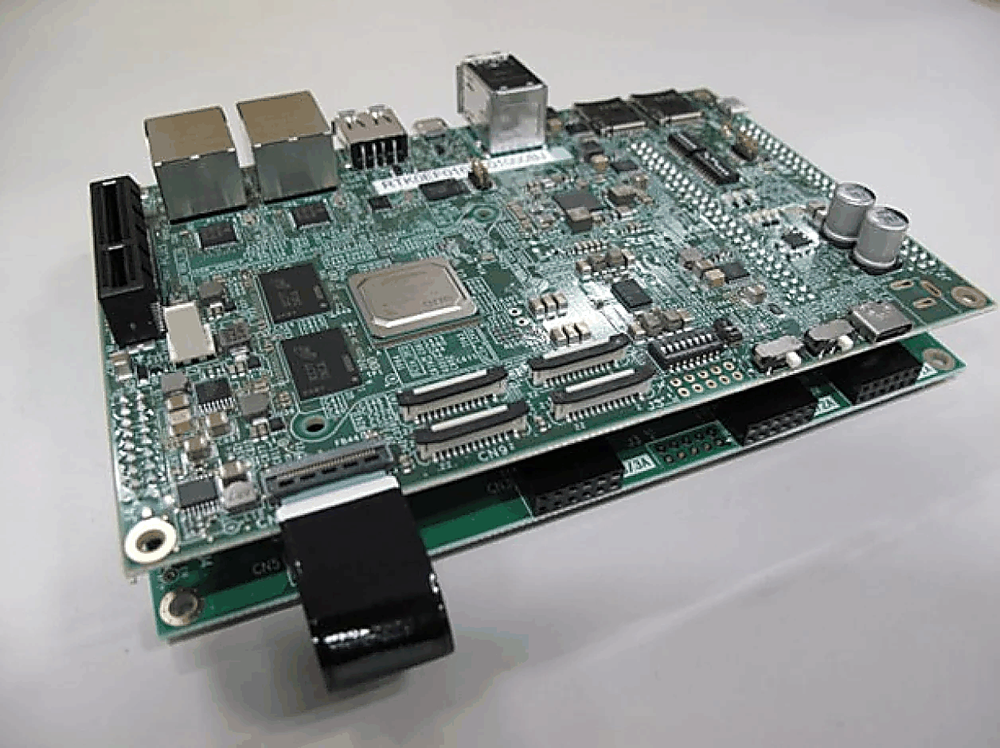
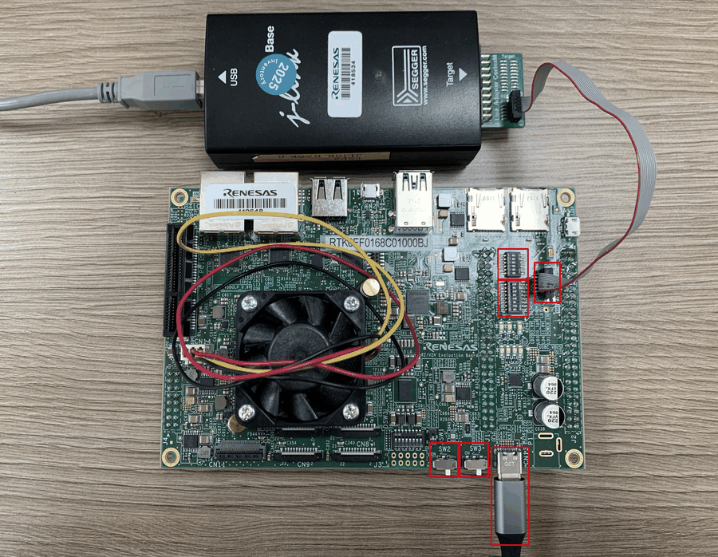

=========
RZV2H-EVK
=========

.. tags:: arch:arm, arch:armv7-r, arch:cortex-r8, chip:rzv2h, vendor:renesas

The RZV2H-EVK is an evaluation board for the Renesas RZ/V2H (R9A09G057)
MPU. NuttX is ported to run on one of the two Cortex-R8 real-time cores
(``CR8_0``).

Board Overview
===============

See the `RZ/V2H product page
<https://www.renesas.com/en/design-resources/boards-kits/rz-v2h-evk#overview>`_
for information about the RZ/V2H MPU.

Board Set-up
============

The following steps set up the board to debug/run NuttX over SWD with a
J-Link debugger:

1. Configure the SWD interface to use the J-Link debugger via the DIP
   switches (highlighted in red in the picture above):

   =====  ===  =====  ===
   DSW 1  Set  DSW 2  Set
   =====  ===  =====  ===
   1-1    ON   2-1    OFF
   1-2    OFF  2-2    OFF
   1-3    ON   2-3    OFF
   1-4    OFF  2-4    OFF
   1-5    ON   2-5    OFF
   1-6    OFF  2-6    OFF
   1-7    ON
   1-8    OFF
   =====  ===  =====  ===

2. Connect CN1 to the J-Link debugger.

3. Make sure SW2 and SW3 are OFF before connecting CN13 to the power
   supply.

4. After CN13 is connected to the power supply, turn SW3 ON first, then
   turn SW2 ON.

To power off the board, reverse the order: disconnect the J-Link debugger
first, then turn SW2 OFF, then SW3 OFF, and only then remove power.

Getting the HAL Renesas
=======================

Clock bring-up (see below) is implemented on top of Renesas' vendored FSP
BSP code, which ships in a separate ``hal_renesas`` repository and is
**not** part of the ``nuttx`` git tree.

``make context`` (run automatically as part of a normal build) clones the
repository at the pinned version into
``arch/arm/src/common/renesas/hal_renesas``, as defined in
``arch/arm/src/common/renesas/Make.defs``. Nothing needs to be cloned
manually. ``make distclean`` removes it.

``HAL_RENESAS_URL`` and ``HAL_RENESAS_VERSION`` can be set in the
environment to use another repository or revision, for example a local
checkout:

.. code-block:: bash

   HAL_RENESAS_URL=/path/to/hal_renesas make

Buttons and LEDs
================

Buttons
-------

The RZ/V2H-EVK has no dedicated user button.  The board port reserves
``P8_2`` for one external, active-high button and exposes it through the
generic NuttX GPIO interface as ``/dev/gpio0``.  It does not currently
provide a discrete NuttX button device such as ``/dev/buttons``.

Hardware connection
~~~~~~~~~~~~~~~~~~~

Locate ``P8_2`` on the selected expansion connector using the RZ/V2H-EVK
schematic.  Connect a normally-open momentary switch between ``P8_2`` and
the board's 3.3-V logic supply, with a common ground between the board and
the external circuit.  The board configures ``P8_2`` as an input with its
internal pull-down enabled:

* button released: the pull-down drives the input low; ``/dev/gpio0`` reads
  ``0``;
* button pressed: the switch drives the input high; ``/dev/gpio0`` reads
  ``1``.

The pin definition is ``BOARD_P8_2_BUTTON`` in
``boards/arm/rzv2h/rzv2h-evk/include/board.h``.  It selects
``BSP_IO_PORT_08_PIN_02`` with input, input-buffer, and pull-down settings.

.. warning::

   ``P8_2`` is a multiplexed pin.  Confirm the EVK schematic and make sure
   that no enabled peripheral claims this pin before connecting the button.

Configuration and registration
~~~~~~~~~~~~~~~~~~~~~~~~~~~~~~

Use a configuration that enables the generic GPIO test path, for example
``rzv2h-evk:nsh-leds``.  The required options are::

   CONFIG_DEV_GPIO=y
   CONFIG_RZV2H_GPIO=y
   CONFIG_EXAMPLES_GPIO=y
   CONFIG_BOARD_LATE_INITIALIZE=y

During ``board_late_initialize()``, ``rzv2h_bringup()`` calls
``rzv2h_gpio_initialize()``.  This registers the one input first as
``/dev/gpio0`` and configures the input through the Renesas FSP IOPORT
driver.  ``CONFIG_RZV2H_GPIO`` defaults to enabled when ``CONFIG_DEV_GPIO``
is selected, but it is shown above to make the dependency explicit.

NSH usage example
~~~~~~~~~~~~~~~~~

After booting NuttX, first verify that the device was registered::

   nsh> ls /dev
   nsh> gpio /dev/gpio0
   Driver: /dev/gpio0
     Input pin:     Value=0

Press and hold the button, then run the read command again::

   nsh> gpio /dev/gpio0
   Driver: /dev/gpio0
     Input pin:     Value=1

Release the button and repeat the command; the value must return to ``0``.
Each invocation of the standard ``apps/examples/gpio`` application performs
one read and exits, so the button must remain pressed for the second command.

Current limitations
~~~~~~~~~~~~~~~~~~~

The current GPIO implementation supports synchronous read and write only.
GPIO interrupt attachment and enablement are placeholders, so ``gpio -w``
cannot report button transitions.  Runtime pin-type changes are also not
implemented, so do not use ``gpio -t``.  The board does not debounce the
external switch; use a polling application with software debounce if
continuous monitoring is required.

LEDs
----

Two active-low GPIO outputs are available for LED testing.  They are
registered after the button input, giving the following device mapping:

.. list-table::
   :header-rows: 1

   * - Pin
     - GPIO device
     - Function
   * - ``P0_0``
     - ``/dev/gpio1``
     - LED output 1
   * - ``P0_1``
     - ``/dev/gpio2``
     - LED output 2

Using the NSH GPIO application
~~~~~~~~~~~~~~~~~~~~~~~~~~~~~~

The ``nsh`` configuration enables ``CONFIG_DEV_GPIO`` and
``CONFIG_EXAMPLES_GPIO``.  The ``gpio`` example is reused from the standard
NuttX application repository at ``apps/examples/gpio``; it is not an
RZ/V2H-specific application.  The RZ/V2H board port only configures the pins,
registers ``/dev/gpio0`` through ``/dev/gpio2``, and enables the example in
the board configuration.  The upstream example source is used without
board-specific polling logic.

The GPIO application uses the following command format::

   gpio [-t <pintype>] [-w <signo>] [-o <value>] <driver-path>

.. note::

   At this stage, the RZ/V2H GPIO driver supports only GPIO read and write
   operations for application testing.  Changing the pin type is not
   supported: ``GPIOC_SETPINTYPE`` does not reconfigure the hardware.
   GPIO interrupt attachment and enablement are also placeholders, so
   interrupt notification is not available.

   Consequently, use only ``gpio <driver-path>`` for reading and
   ``gpio -o <0|1> <driver-path>`` for writing.  Do not use the ``-t``
   pin-type option or the ``-w`` interrupt-wait option on this board.

For these LED outputs, only ``-o`` and the device path are needed.  The
``-o`` option writes the logical pin level (zero or one), while the device
path selects the LED.  Because the LEDs are active low, write zero to turn an
LED on and one to turn it off.  For example::

   nsh> gpio -o 0 /dev/gpio1
   nsh> gpio -o 1 /dev/gpio1
   nsh> gpio -o 0 /dev/gpio2
   nsh> gpio -o 1 /dev/gpio2

For each command, the application reports the previous output level, the
level being written, and the level read back from the driver.  For example,
if LED output 1 is currently off::

   nsh> gpio -o 0 /dev/gpio1
   Driver: /dev/gpio1
     Output pin:    Value=1
     Writing:       Value=0
     Verify:        Value=0

Omit ``-o`` to read the current output level without changing it::

   nsh> gpio /dev/gpio1

Each invocation performs a single GPIO operation and then exits.  This is
sufficient for the manual button and LED validation described here.

Use ``gpio -h`` to display the generic application's command syntax.  Some
options shown by that help text are not yet supported by the RZ/V2H GPIO
driver, as described above.

Using the NuttX user-LED application
~~~~~~~~~~~~~~~~~~~~~~~~~~~~~~~~~~~~

The ``nsh-leds`` configuration also enables the standard NuttX user-LED
interface and example with these options::

   # CONFIG_ARCH_LEDS is not set
   CONFIG_USERLED=y
   CONFIG_USERLED_LOWER=y
   CONFIG_EXAMPLES_LEDS=y
   CONFIG_BOARD_LATE_INITIALIZE=y

During late initialization, the board registers ``/dev/userleds``.  The
``board_userled_*()`` callbacks configure ``P0_0`` and ``P0_1``, convert the
logical LED state to the active-low pin level, and support LED mask bits
``0x01`` and ``0x02``.

Run the unmodified NuttX example from ``apps/examples/leds`` to cycle the two
LED outputs::

   nsh> ls /dev
   nsh> leds

The device list should contain ``userleds``, and the example should report a
supported LED mask of ``0x03``.  The ``leds`` command starts a background
``led_daemon`` that cycles the LED mask.  Its startup message prints the
daemon PID; use ``kill <pid>`` to stop it.

This interface is separate from the generic ``/dev/gpio1`` and
``/dev/gpio2`` devices.  Use the ``gpio`` example for individual read/write
validation, or use the ``leds`` example to exercise the NuttX user-LED API.
Automatic OS-status LED control through ``CONFIG_ARCH_LEDS`` is not yet
implemented.

Application test responsibilities
~~~~~~~~~~~~~~~~~~~~~~~~~~~~~~~~~

The current button and LED tests both reuse the standard NuttX GPIO example:

.. list-table::
   :header-rows: 1

   * - Test
     - Application source
     - Responsibility
   * - Button read test
     - Standard NuttX ``apps/examples/gpio`` application
     - Press and hold the button, then read ``/dev/gpio0``
   * - LED read/write test
     - Standard NuttX ``apps/examples/gpio`` application
     - Reused unchanged; the board port only configures and registers the
       LED GPIO devices
   * - User-LED sequence test
     - Standard NuttX ``apps/examples/leds`` application
     - Reused unchanged; it controls both active-low outputs through
       ``/dev/userleds``

.. important::

   No RZ/V2H-specific test application is required for the current manual
   validation.  Use the standard NuttX ``gpio`` example to read the button
   through ``/dev/gpio0`` and to control the LEDs through ``/dev/gpio1`` and
   ``/dev/gpio2``.  A separate polling application is needed only if
   continuous monitoring, transition detection, or debounce testing is
   required later.

   The GPIO devices are registered from the board late-initialization path, so
   ``CONFIG_BOARD_LATE_INITIALIZE`` must remain enabled.

   The user-controlled ``board_userled_*()`` hooks and ``/dev/userleds`` are
   supported.  The automatic ``board_autoled_*()`` hooks selected by
   ``CONFIG_ARCH_LEDS`` remain placeholders.

Serial Consoles
===============

The default ``nsh`` configuration uses SCI channel 0 as the serial console
at 115200 baud, 8 data bits, no parity, and one stop bit. The board pin
definitions route SCI0 as follows:

======  ========  =======================
Signal  Pin       Board definition
======  ========  =======================
TXD0    ``P5_0``  ``BOARD_SCI0_TXD_GPIO``
RXD0    ``P5_1``  ``BOARD_SCI0_RXD_GPIO``
======  ========  =======================

Connect the USB-to-UART adapter to the CN3 Pmod contacts shown below:

========  ==========  ========  =========================
CN3 pin   CN3 signal  SoC pin   USB-to-UART connection
========  ==========  ========  =========================
1         CTS         ``P52``   RTS (Unused)
2         TXD0        ``P50``   RX
3         RXD0        ``P51``   TX
4         RTS         ``P53``   CTS (Unused)
5         GND         --        GND
6         VCC         --        VCC
7         IO1         ``P57``   Unused
8         IO2         ``P73``   Unused
9         IO3         ``P76``   Unused
10        IO4         ``P77``   Unused
11        GND         --        Unused
12        VCC         --        Unused
========  ==========  ========  =========================

Cross the data lines so that CN3 TXD0 connects to the adapter RX and CN3
RXD0 connects to the adapter TX. Hardware flow control is not enabled, so
CTS and RTS remain disconnected. Use a 3.3 V TTL UART adapter, not an RS-232
adapter. The table assumes that the adapter is powered through USB; do not
connect either CN3 VCC contact to the adapter.

The relevant default options are::

   CONFIG_RZV2H_UART_SCI=y
   CONFIG_RZV2H_SCI_B_UART0=y
   CONFIG_SCI0_SERIAL_CONSOLE=y
   CONFIG_SCI0_BAUD=115200
   CONFIG_SCI0_BITS=8
   CONFIG_SCI0_PARITY=0
   CONFIG_SCI0_2STOP=0

After boot, SCI0 is available as both ``/dev/console`` and ``/dev/ttyS0``.
The terminal should display the NuttX banner followed by the ``nsh>`` prompt.
Verify the registration with::

   nsh> ls /dev
   /dev:
    console
    null
    ttyS0
    zero

Additional enabled SCI channels are registered as later ``/dev/ttyS*``
devices in ascending hardware-channel order. Their TX and RX pin choices are
board-specific and are defined by ``BOARD_SCIn_TXD_GPIO`` and
``BOARD_SCIn_RXD_GPIO`` in ``boards/arm/rzv2h/rzv2h-evk/include/board.h``.

Bring-up
========

This section describes what has been brought up so far for the CR8_0 core.
Clock, MPU, GIC, timer, GPIO, and SCI-B UART support described on this
page are implemented.  Board options not described here may still be
placeholders.

Clock control
-------------

``rzv2h_clockconfig()`` (``arch/arm/src/rzv2h/rzv2h_clockconfig.c``) calls
into ``bsp_clock_init()`` from the vendored Renesas FSP BSP
(``arch/arm/src/common/renesas/hal_renesas/...``), which programs the PLL and clock
tree. The system tick timer (see Timer below) derives its input clock from
the resulting ``BSP_CFG_CLOCK_I6CLK_HZ`` value, so this must run before the
timer is configured.

MPU enablement
--------------

``arch/arm/src/rzv2h/rzv2h_mpu_region.c`` defines a static PMSAv7 region
table (``g_mpu_region_table[]``) for CR8 core 0:

- Region 0 - ITCM (0x00000000, 128 KB), read-only, holds the exception
  vector table copied there by ``arm_boot()``.
- Region 1 - DTCM (0x00020000, 128 KB), read/write, execute-never.
- Region 2 - RCPU-SRAM (cacheable), read/write, execute-never default for
  the whole image range.
- Last region - the read-only code window (``__mpu_code_start`` ..
  ``__mpu_code_end``, provided by the linker script), read-only and
  executable, layered on top of region 2 so code remains executable while
  data stays non-executable.

Because PMSAv7 lets the highest-numbered matching region win, the
executable code window must be the last entry in the table, and its size
must be padded to a power of two by the linker script to satisfy PMSAv7's
size/alignment rule.

Interrupt initialization
------------------------

``up_irqinitialize()`` (``arch/arm/src/rzv2h/rzv2h_irq.c``) brings up the
Generic Interrupt Controller (GIC): ``arm_gic0_initialize()`` runs once, on
CPU0 only, followed by ``arm_gic_initialize()`` on every CPU. Interrupts are
then unmasked with ``up_irq_enable()``.

Beyond the GIC's fixed interrupt lines, the CR8 core's INTC also exposes a
pool of 127 programmable "SEL" lines used by peripherals and the TINT
pin-interrupt controller.

Timer
-----

``arch/arm/src/rzv2h/rzv2h_timerisr.c`` uses the Arm MPCore Private Timer
as the system tick source. Its clock is ``BSP_CFG_CLOCK_I6CLK_HZ / 2``, and
the reload value is derived from ``CLK_TCK`` so the timer fires every system
tick. The Private Timer interrupt (BSP IRQn -3) maps to GIC INTID 29.

Loading Code
============

Use a J-Link or another SWD/JTAG probe to load debugger configurations.

Configurations
==============

nsh
---

NuttShell configuration exercising clock, MPU, interrupt/timer, GPIO, and
SCI-B UART bring-up on CR8_0. SCI0 provides the default 115200-8N1 NSH
console through CN3 and is registered as ``/dev/console`` and
``/dev/ttyS0``.

nsh-leds
--------

This configuration enables ``CONFIG_USERLED``, registers ``/dev/userleds``,
and includes the standard NuttX ``leds`` example.  Run ``leds`` to cycle the
active-low ``P0_0`` and ``P0_1`` LED outputs.  The generic ``/dev/gpio1`` and
``/dev/gpio2`` interfaces are also available for individual read/write
testing.  Automatic OS-status LED control through ``CONFIG_ARCH_LEDS`` is
not yet implemented.
