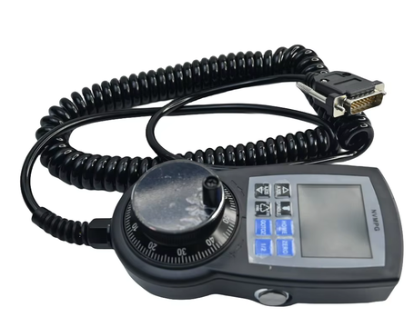

=============
nvmpg-stm32f1
=============

.. tags:: arch:arm, chip:stm32f1, part:stm32f103, vendor:st

   Digital Dream NVMPG CNC pendant

The NVMPG is a hand-held MPG (Manual Pulse Generator) pendant made by Digital
Dream for its NVUM, NVEM, EC300 and EC500 CNC motion controllers. It has a
handwheel, ten push buttons and a 2.0" color TFT display that shows the axis
positions, the feed/spindle/jog overrides and the MPG step that the
controller reports over a serial link.

Inside it there is an STM32F103RCT6 that drives the display, scans the keys
and talks to the controller. The handwheel encoder and the E-stop are not
connected to the MCU: they are wired straight through the cable to the
controller.

This port replaces the original firmware. The ``dro`` configuration speaks the
same serial protocol, so the pendant keeps working with the controller.

Features
========

* STM32F103RCT6: Cortex-M3, 256 KiB of FLASH and 48 KiB of SRAM
* ILI9225 176x220 RGB565 TFT display on a 16-bit 8080 parallel bus, used in
  landscape mode (220x176)
* 10 push buttons
* USART1 link to the CNC controller (115200 8N1)
* SWD debug interface

.. note::

   The display bus is driven by bit-banging GPIOs (GPIOB is the 16-bit data
   bus), not through the FSMC, because the STM32F103RC in its 64-pin package
   has no FSMC. The upstream ``drivers/lcd/ili9225.c`` driver only supports
   SPI, so this board provides its own ``lcd_dev_s`` implementation in
   ``src/stm32_ili9225.c``.

Buttons and LEDs
================

There are no user LEDs.

The ten buttons are active-low inputs with external pull-up resistors. They
are registered as ``/dev/gpio0`` .. ``/dev/gpio9`` (``CONFIG_DEV_GPIO``) and
polled by the application: PA0-PA3 and PC0-PC3 share the same EXTI lines, so
they cannot all be used as interrupt buttons.

======= ===== ============== ==========================
Device  Pin   Code (press)   Button
======= ===== ============== ==========================
gpio0   PA2   0x02           Axis Up
gpio1   PA1   0x03           Axis Down
gpio2   PA0   0x04           Spindle
gpio3   PC3   0x05           Step (x1, x10, x100)
gpio4   PC2   0x06           Home
gpio5   PC1   0x07           GOTOZ
gpio6   PC0   0x08           Zero
gpio7   PC15  0x09           1/2
gpio8   PC14  0x0A           Right Side button (START)
gpio9   PA3   0x0B           Left Side button (STOP)
======= ===== ============== ==========================

The code column is the byte sent to the controller when the key is pressed.
The release code is the same value with bit 7 set (``code | 0x80``).

Serial Protocol
===============

The pendant is a slave of the controller. All the information on the display
comes from the controller, and the pendant only reports key events. For
instance, pressing the Step key sends ``0x05``; the controller then changes the
MPG step and reports the new value back, and only then the display changes.

Controller to pendant:

* ``5A 5A`` followed by a 51-byte status frame (no checksum).
* ``5A 5B``: identify request. The pendant answers ``01 13``.

Status frame layout (little-endian):

====== ======= =========================================================
Offset Type    Meaning
====== ======= =========================================================
0x00   int32   X position, in 0.0001 units
0x04   int32   Y position
0x08   int32   Z position
0x0C   int32   A position
0x10   int32   B position
0x14   int32   C position
0x19   uint8   RESET lamp: 0 = green, otherwise red
0x1B   int32   Value shown in the lower right box (5 digits)
0x1F   uint8   COMM lamp: 0 = off, otherwise yellow
0x20   uint8   FRO, feed rate override (%)
0x21   uint8   SJR, slow jog rate (%)
0x22   uint8   SRO, spindle rate override (%)
0x24   uint8   Selected override: 0 = none, 1 = FRO, 2 = SJR, 3 = SRO
0x25   uint8   Selected axis: 0..5 = X..C. 0..2 shows the XYZ page and
               3..5 the ABC page
0x26   uint8   MPG step: 0 = x1, 1 = x10, 2 = x100, 3 = x1000
====== ======= =========================================================

The fields at 0x19, 0x1B and 0x1F were identified from how the original
firmware draws them; their exact meaning depends on the controller.

Pin Mapping
===========

===== ============= ===================================================
Pin   Signal        Notes
===== ============= ===================================================
PB0   LCD D0        PB0..PB15 are the 16-bit LCD data bus
...   ...
PB15  LCD D15
PC10  LCD /WR
PC11  LCD RS        0 = index register, 1 = data
PC12  LCD /CS
PA15  LCD /RD
PA9   USART1 TX     To the controller
PA10  USART1 RX     From the controller
PA13  SWDIO
PA14  SWCLK
PA0   Key           See `Buttons and LEDs`_
PA1   Key
PA2   Key
PA3   Key
PC0   Key
PC1   Key
PC2   Key
PC3   Key
PC14  Key
PC15  Key
===== ============= ===================================================

The LCD reset line is not connected to the MCU. PB3 and PB4 are only usable
as GPIOs with JTAG-DP disabled, so the board is configured with
``CONFIG_STM32_JTAG_SW_ENABLE`` (SWD only).

Power Supply
============

The pendant is powered with 5 V by the controller through the MPG cable.

Clock
=====

The original firmware clocks the PLL from HSI/2, so it is not known for sure
which crystal is fitted to the board. By default the port does the same
(HSI/2 x 16 = 64 MHz), which works whatever crystal is fitted.

* ``CONFIG_NVMPG_STM32F1_HSE_8MHZ``: clock the PLL from an 8 MHz HSE crystal
  instead, for a 72 MHz system clock.

Installation
============

The toolchain and build environment are the same as for the other STM32F1
boards; see :doc:`/quickstart/install`.

Building NuttX
==============

.. code:: console

   $ ./tools/configure.sh nvmpg-stm32f1:dro
   $ make

Flashing
========

The board is programmed through SWD (PA13/PA14) with an ST-Link probe and
OpenOCD:

.. code:: console

   $ openocd -f interface/stlink.cfg -f target/stm32f1x.cfg \
       -c "program nuttx.bin 0x08000000 verify reset; shutdown"

ST-Link clones with old firmware (older than V2J24) only work with the
``interface/stlink-hla.cfg`` interface script.

.. warning::

   Back up the original firmware before flashing NuttX, for instance with
   ``dump_image nvmpg-original.bin 0x08000000 0x40000`` from OpenOCD, if you
   want to be able to restore it later.

The board configuration sets ``DBGMCU_CR.DBG_SLEEP`` at boot, so the debugger
can attach to the running firmware even while the CPU is sleeping in the idle
loop.

Configurations
==============

.. code:: console

   $ ./tools/configure.sh nvmpg-stm32f1:<config-name>

dro
---

Replacement firmware for the pendant. It starts the
:doc:`nvmpg-dro </applications/industry/cnc/nvmpg-dro/index>` application
directly (``CONFIG_INIT_ENTRYPOINT="nvmpg_dro_main"``). There is no NSH
console: USART1 is used for the link to the controller (``/dev/ttyS0``).

At power up the NuttX logo is shown for one second, then the DRO screen: the
axis positions, the FRO/SJR/SRO overrides, the MPG step, and the RESET and
COMM lamps. The positions are drawn in grey when no frame was received from
the controller for one second.
