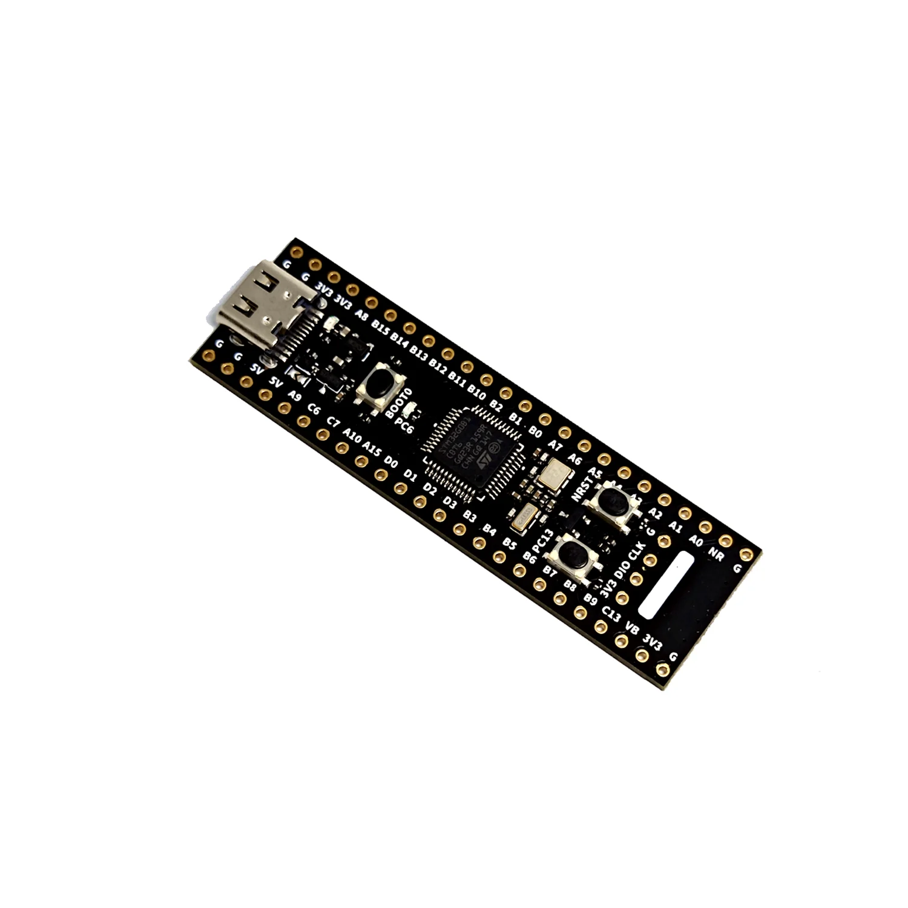

======================
WeAct Studio STM32G0B1
======================

.. tags:: arch:arm, chip:stm32g0, vendor:st

This page discusses issues unique to NuttX configurations for the
WeAct STM32G0B1 board.

Board information
=================

The board features:

- nRST reset button and BOOT0 ST BootROM entry button,
- One user LED and one user push-button,
- HSE 8 Mhz and LSE 32.768 kHz,
- USB OTG FS with Type-C connector,
- Serial Wire Debug header for use with an external SWD/JTAG adapter.

LED
====

The WeAct STM32G0B1 board has only one software controllable LED on PC6.
This LED can be used by the board port when CONFIG_ARCH_LEDS option is
enabled.

If enabled the LED is simply turned on when the board boots
successfully, and is blinking on panic / assertion failed.

Button
=======

The WeAct STM32G0B1 board has only one button on PC13.

Serial Console
==============

The default console is on USART3:

  ========== =====
  UART/USART PINS
  ========== =====
  TX         PB8
  RX         PB9
  ========== =====

Configurations
==============

nsh
---

Configures the NuttShell (nsh) located at apps/examples/nsh. This
configuration enables a serial console on UART3.

userled
-------

This is a config example to blink onboard led with userled driver and leds example.

buttons
-------

This is a config example to test onboard user button with input driver and buttons example in signal mode.

