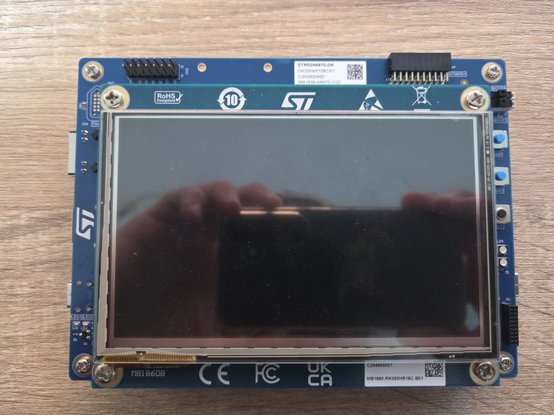
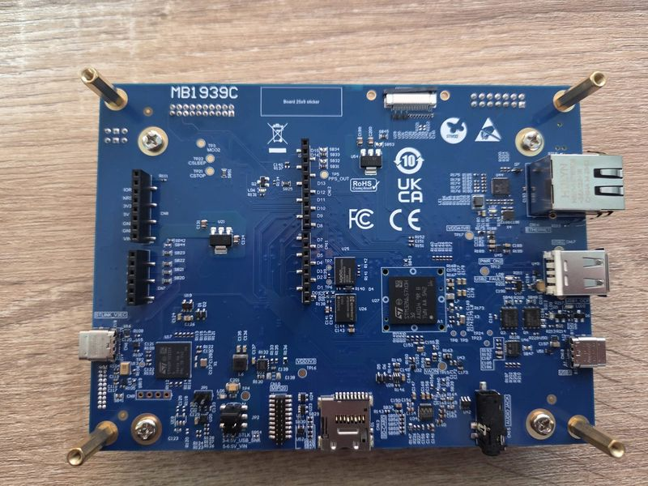

================
ST STM32N6570-DK
================

.. tags:: chip:stm32, chip:stm32n6, chip:stm32n657

   STM32N6570-DK Front

   STM32N6570-DK Back

The STM32N6570-DK Discovery kit is based on the STM32N657X0H3Q
Arm Cortex-M55 microcontroller.

Loading and running
===================

Use SRAM loading for routine debugging and external flash for persistent
boot, reset testing and standalone operation.  The console is the ST-LINK
Virtual COM Port at 115200 8N1.

Persistent flash
----------------

OpenOCD adds the STM32N6 ROM header to ``nuttx.bin`` and programs the
on-board NOR flash with its ``stmqspi`` driver.  Use an OpenOCD version
that provides ``target/stm32n6x.cfg``.

Build and program the persistent boot image with:

.. code:: console

   $ make flash

This erases the affected flash sectors, programs and verifies the image,
and resets the board.  ``OPENOCD`` and ``OPENOCD_TARGET`` can override the
OpenOCD executable and target script.  The board's ``scripts/flash.cfg``
configures the NOR pins, clocks and geometry for the native flash driver.

For a CMake build configured in ``build``:

.. code:: console

   $ cmake --build build --target flash

Both targets build ``nuttx.bin`` before flashing.  With CMake, ``OPENOCD``
and ``OPENOCD_TARGET`` are cache variables set with ``-D`` at configuration.

The boot ROM loads NuttX from flash and starts it without a debugger or
separate FSBL.
The header and padding occupy the first 1 KiB at ``0x34180000``; NuttX is
linked at ``0x34180400``.  The ROM download buffer limits the binary to
511 KiB.  The generated image is unauthenticated and requires a device
that permits unauthenticated boot.

SRAM debugging
--------------

Build with ``make`` or ``cmake --build build``.  Start OpenOCD using its
standard ST-LINK and STM32N6 scripts:

.. code:: console

   $ openocd -f interface/stlink.cfg -c 'transport select swd' \
         -f target/stm32n6x.cfg -c 'reset_config srst_only srst_nogate'

In another terminal, open the ELF with GDB.  Use ``build/nuttx`` instead of
``nuttx`` for CMake:

.. code:: console

   $ arm-none-eabi-gdb nuttx
   (gdb) target extended-remote :3333
   (gdb) monitor reset halt
   (gdb) load
   (gdb) set $msp = *(unsigned int *)0x34180400
   (gdb) set $pc = *(unsigned int *)0x34180404
   (gdb) hbreak nx_start
   (gdb) continue

``load`` writes the ELF sections into SRAM without programming external
flash.  The next two commands initialize the stack pointer and entry point
from the vector table.  Continue again after reaching ``nx_start`` to run
NSH.  Reset before each reload; resetting after ``load`` boots the image
stored in flash instead.  The SRAM image is lost on power-off.

To inspect an already running image, attach with its matching ELF and omit
the reset, load and register-setting commands.

NSH enables ``CONFIG_STM32N6_DEBUG`` to reopen debug access after ROM boot
and includes debug symbols.  These debugging steps require an installed
image that enables debug access.  Stop GDB and OpenOCD before running either
flash target.

LEDs and buttons
================

===== ===== ======================================
Name  Pin   Notes
===== ===== ======================================
LD1   PO1   Green, active high
LD2   PG10  Red, active low
USER1 PC13  Button B2, EXTI13, high when pressed
TAMP  PE0   Button B4, EXTI0, high when pressed
===== ===== ======================================

The LEDs are available through ``/dev/userleds`` and the buttons through
``/dev/buttons`` in the nsh configuration.

RTC
===

The RTC runs from the 32.768 kHz LSE crystal and is registered as
``/dev/rtc0`` with two alarms.  Set the time with ``date -s`` and test the
alarms with the ``alarm`` example, e.g. ``alarm 5`` or ``alarm -a 1 5``.
The time survives a reset; without a backup battery it is lost on power
off.

I2C
===

===== ============ ============================================
Bus   Pins         Devices
===== ============ ============================================
I2C1  PH9, PC1     Camera module connector, Arduino D15/D14
I2C2  PD14, PD4    WM8904 codec (0x1a), GT911 touch (0x5d), TCPP03
I2C4  PE13, PE14   STMod+ connector
===== ============ ============================================

The buses are registered as ``/dev/i2c1``, ``/dev/i2c2`` and ``/dev/i2c4``
and can be explored with the ``i2c`` tool.

Serial ports
============

====== ====== ======================================== ====================
Port   Device Pins                                     Connection
====== ====== ======================================== ====================
USART1 ttyS0  PE5 TX, PE6 RX                           ST-LINK VCP, console
USART2 ttyS1  PD5 TX, PF6 RX, PG5 CTS, PG14 RTS        STMod+ connector
====== ====== ======================================== ====================

SPI
===

SPI5 is wired to the Arduino connector: PE15 SCK (D13), PH8 MISO (D12),
PG2 MOSI (D11) and PA3 as chip select (D10).  It is registered as
``/dev/spi5`` and can be exercised with the ``spi`` tool; shorting D11
to D12 loops the transmitted bytes back.

Ethernet
========

The RJ45 port is driven by a Realtek RTL8211F gigabit PHY at MDIO address 1,
connected to ETH1 over RGMII: PD1 MDC, PD12 MDIO, PF0 GTX_CLK, PF2 CLK125,
PF7 RX_CLK, PF10 RX_CTL, PF14/PF15/PF8/PF9 RXD0-3, PF11 TX_CTL and
PF12/PF13/PG3/PG4 TXD0-3.  The PHY is managed by PHYLIB with its RTL8211F
driver, which adds the RGMII clock delays (``PHY_INTERFACE_RGMII_ID``), and
its 125 MHz CLK125 output clocks the MAC.  The MAC address is derived from the unique
device ID.  The interface is ``eth0``; check it with ``ifconfig`` and
``ping``, and read the PHY registers with ``mdio``.

LCD
===

The 5" 800x480 Rocktech RK050HR18 panel is driven by the LTDC (RGB888
output, pins in ``board.h``) and registered as ``/dev/fb0``.  The 25 MHz
pixel clock is IC16 (PLL1 / 96).  PQ3 enables the panel, PQ6 the backlight
and PE1 is the shared panel/touch reset.  Layer 1 is RGB565 and its
framebuffer is placed in AXISRAM1/2 at 0x34080000 (768000 bytes), below
the image, so the heap is not affected.  Run ``fb`` to draw the test
pattern.

The GT911 touch controller on I2C2 (interrupt on PQ4) is reset at bring-up
with PQ4 held low, which selects address 0x5d, and registered as
``/dev/input0``; ``tc`` prints the touch coordinates.

Time-of-flight sensor
=====================

The VL53L5CX on the camera module (MB1854) is on I2C1 at 0x29, with INT on
PQ0 and LPn on PQ5.  The board powers the module through PD2 with the
IMX335 held in reset (PC8) and registers the sensor as the V4L2 depth
camera ``/dev/video1`` (Z16, 8x8 or 4x4).  INT uses EXTI0, so the TAMP
button has no interrupt when the sensor is enabled.

microSD
=======

The microSD slot is on SDMMC2 (4-bit, IDMA): PC2 CK, PC3 CMD, PC4-PC5 D0-D1,
PC0 D2, PE4 D3 (AF11), card detect PN12 (low with a card) and card power
enable PQ7 (high).  The kernel clock is IC4 = 200 MHz, giving 400 kHz for
identification and 25 MHz for transfers.  The card is ``/dev/mmcsd0``;
insertion and removal are reported through the card detect interrupt.
With a FAT formatted card::

  nsh> mount -t vfat /dev/mmcsd0 /mnt
  nsh> echo hello > /mnt/test.txt
  nsh> cat /mnt/test.txt
  nsh> dd if=/dev/zero of=/mnt/big.bin bs=4096 count=256
  nsh> umount /mnt

USB host
========

The host runs at full speed on the embedded PHY (24 MHz reference, HSE / 2)
of the port selected with ``CONFIG_STM32N6_OTGHS_USB1``/``USB2``:

* USB2 (default in ``usbhost``): the Type-A connector, VBUS switched by PB9.
* USB1: the Type-C connector (CN18).  VBUS comes from the TCPP03: PA4
  enables it and the host driver closes its provider switch over I2C2
  (0x34).  The CC lines are not driven.  Not tested on hardware.

VBUS of a flash drive can exceed what the ST-LINK USB port supplies: power
the board from CN18 when using the Type-A port.  A FAT formatted flash
drive is ``/dev/sda``::

  nsh> mount -t vfat /dev/sda /mnt
  nsh> ls /mnt
  nsh> echo hello > /mnt/test.txt
  nsh> umount /mnt

Clocking
========

By default the CPU runs at 800 MHz and the system buses at 400 MHz.  PLL1 is
fed from the 48 MHz HSE crystal, HCLK and the APB clocks run at 200 MHz and
the timer kernel clock is 200 MHz.  800 MHz requires the VOS high voltage
range, so the board SMPS is switched to its overdrive output through PF4
before the PLL is started.  PLL2, PLL3 and PLL4 are started for the
peripheral kernel clocks.

``CONFIG_STM32N6570_DK_CLOCK_HSI`` selects a conservative tree instead: PLL1
from the internal 64 MHz HSI, CPU 200 MHz, SYSCLK 100 MHz and VOS low.  The
console USART1 is clocked from HSI in both cases.

Configurations
==============

nsh
---

NuttShell with the user LEDs, the USER1 button, GPDMA1 and the RTC
enabled.

netnsh
------

The ``nsh`` configuration with Ethernet: IPv4, TCP, UDP, ICMP, a DHCP
client started by NSH, ``ping``, ``telnetd`` and ``mdio``.  The link is
auto-negotiated up to 1000 Mbps when ``eth0`` comes up.

fb
--

``nsh`` plus the LCD framebuffer ``/dev/fb0`` and the ``fb`` example, which
draws nested coloured rectangles on the panel.

lvgl
----

``fb`` plus the touch controller, LVGL and its widgets demo.  Start it
with ``lvgldemo &``.  The image is close to the 511 KiB limit of the boot
ROM, so LVGL logging and extra fonts are left out.

sdcard
------

NuttShell with the microSD slot on SDMMC2 and the FAT file system, see
`microSD`_.

usbhost
-------

The ``nsh`` configuration with the USB host on the USB2 Type-A
connector, the mass storage class and the FAT file system, see `USB host`_.
