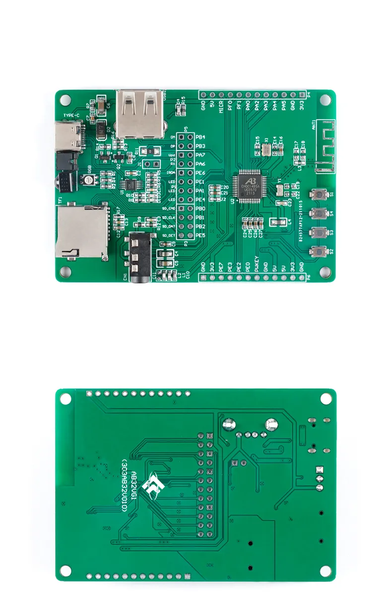

=================================
AB32VG1 generic development board
=================================

.. tags:: arch:risc-v, chip:ab32vg1, vendor:bluetrum

   The AB32VG1 development board, top and bottom.

This is a compact (83 x 55 mm) AB32VG1 board sold by several vendors on
AliExpress and similar marketplaces simply as "AB32VG1 Development Board".
It has no model name of its own.  It is derived from Bluetrum's official
AB32VG1-AB-PROUGEN board but drops its Arduino Uno headers: the chip pins go
to two single-row headers, and the on-board peripherals are connected to the
chip through jumpers on a double-row header in the middle of the board.

The circuit follows the AB32VG1-AB-PROUGEN schematic (V02, in
https://github.com/BLUETRUM/AB32VG1_DOC together with the datasheet and
register manual).  The header names used below (P1, P5, P6) are the ones of
that schematic; on this board the corresponding jumpers are part of the
double-row header, labelled with signal names (``PB4``, ``PB3``, ``Upd``,
``PA7``...) instead.

Features
========

* Bluetrum AB32VG1 (AB5301A) SoC, 26 MHz and 32.768 kHz crystals, PCB
  antenna
* RGB LED (common anode, active low) through jumpers: red PE1, green PE4,
  blue PA1 (PROUGEN schematic V02; the PROUGEN user manual says PA2)
* Buttons: S1 reset (switches the board supply), S2/KEY1 (PF1), S3/KEY2
  (PF0); S4 is not supported yet
* CH340 USB-serial bridge on the USB-C connector, wired as a single wire to
  PA7 (the mask ROM download pin and the NuttX console)
* USB-A plug on PB3/PB4 (USB D+/D-), TF card slot, audio jack (headphones,
  microphone, FM antenna), IR receiver

Jumpers
=======

**J1** must be fitted: it powers the programming side of the board (the
CH340 and the isolator).  Without it nothing reaches PA7 and the host does
not even see the echo of what it sends.

The CH340 TX and RX (nets ``URX0`` and ``Update``) are joined into one wire
through 200 ohm and reach the chip through jumpers (header P6 in the
schematic): one connects PA6 to ``URX0``, the other **PA7** to ``Update``
(labelled ``Upd``).  The ``PA7``/``Upd`` jumper must be fitted for the
console and for ``ab32vg1_dl``.

The ``PB3``/``PB4`` jumpers (header P5 in the schematic) connect the USB
D+/D- of the chip to the USB-A plug, whose D+ is labelled ``DP(upDate)`` in
the schematic.  They are not used by NuttX.

Serial Console
==============

The console is UART0 in single-wire mode on PA7, 115200 8N1, on the
USB-serial port of the board (``/dev/ttyUSB0`` on Linux).

Because TX and RX share one wire, everything the host sends is echoed back
by the hardware, and the host and NuttX must not transmit at the same time.
Interactive use with a terminal program works (characters typed by a human
are far apart), but scripts must wait for each echo before sending the next
byte.  ``ab32vg1_dl term`` removes the hardware echo.

Installation
============

1. Install a RISC-V toolchain, e.g. the xPack GNU RISC-V Embedded GCC
   (``riscv-none-elf-gcc``) from https://xpack-dev-tools.github.io/.

2. Build the host tool, which also cross-compiles its target helpers:

   .. code:: console

      $ make -C boards/risc-v/ab32vg1/ab32vg1-generic/tools

   This produces ``boards/risc-v/ab32vg1/ab32vg1-generic/tools/ab32vg1_dl``.
   It needs only a C compiler and the RISC-V toolchain; no vendor tool
   (Downloader, xmaker) is used.

Building NuttX
==============

.. code:: console

   $ ./tools/configure.sh ab32vg1-generic:nsh
   $ make

The result to load is the ELF file ``nuttx`` (the image has more than one
segment, so ``nuttx.bin`` is not used).

Loading and Flashing
====================

``ab32vg1_dl`` talks to the mask ROM UART loader, which listens on PA7 for a
short time after every reset.  When the tool says *waiting for the ROM
loader*, press the reset button (S1).  If the board is already running
NuttX, no button is needed: the tool sends a key that makes NuttX reset
itself into the ROM loader (``CONFIG_AB32VG1_UART0_ROMKEY``).

Run from RAM (development; nothing is written to flash):

.. code:: console

   $ ab32vg1_dl run -t nuttx

Write to flash, so that NuttX boots at power on:

.. code:: console

   $ ab32vg1_dl -F flash -t nuttx

``flash`` writes a boot sector (a Bluetrum boot header with the NuttX
stage-1 loader), an image table and the NuttX segments, verifies everything
by CRC-32 and resets the board.  At power on the mask ROM starts the stage-1
loader, which copies NuttX to RAM, checks it and starts it.

.. warning::

   Writing the boot sector replaces the vendor boot code, and with it the
   only path by which the mask ROM UART loader is reached at reset.  The
   mask ROM watches CPU register 0x508: the boot code must clear it, and if
   it does not do so in time the ROM takes control back into its UART
   loader.  The vendor boot code clears it and then calls a ROM routine that
   listens for the host.  A first version of the NuttX stage-1 loader
   cleared 0x508 without listening; after flashing it, the board boots
   NuttX fine but could no longer be reached by the ROM loader, neither
   through PA7 nor PB3, after power-on or watchdog resets, at any baud rate
   or with a break condition on the line, nor through USB.

   The current stage-1 loader listens on PA7 for 8 ms before clearing 0x508
   and leaves 0x508 set when it sees the host tool, so that the ROM loader
   takes over.  **This has not been verified on hardware yet**, which is why
   ``ab32vg1_dl`` refuses to write the boot sector without ``-F``.  Until it
   is, prefer ``run`` (RAM) or ``flash -n`` (image only, with
   ``boottest``).

Before flashing NuttX for the first time it is a good idea to keep a copy of
the factory firmware:

.. code:: console

   $ ab32vg1_dl read 0 0x100000 factory.bin     # backup
   $ ab32vg1_dl write 0 factory.bin             # restore

Other commands: ``info`` (chip and flash IDs), ``erase``, ``reset``,
``mkimage`` (write the flash image to a file), ``boottest`` (run the stage-1
loader from RAM to test an image without changing the boot sector) and
``term``.  Run ``ab32vg1_dl`` without arguments for the details.

Flash layout:

==========  ==============================================================
Offset      Content
==========  ==============================================================
0x000000    Boot header (scrambled) and stage-1 loader, 4 KB
0x001000    Image table: entry point, segments (flash offset, load
            address, size, CRC-32)
0x002000    NuttX segments
==========  ==============================================================

Configurations
==============

All configurations use UART0 (PA7) at 115200 baud as console.

nsh
---

NuttShell with procfs, the ``hello`` and ``leds`` examples and ``reboot``.
The RGB LED is available as ``/dev/userleds``.

ostest
------

Runs the OS test suite (``testing/ostest``) at boot instead of the shell.
Expected end of the output::

   user_main: Exiting
   ostest_main: Exiting with status 0
