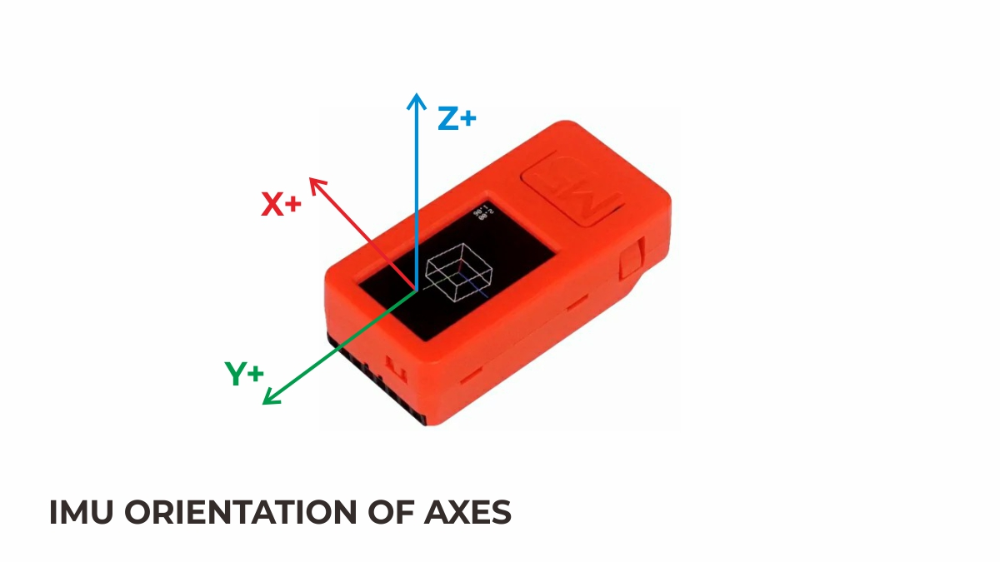
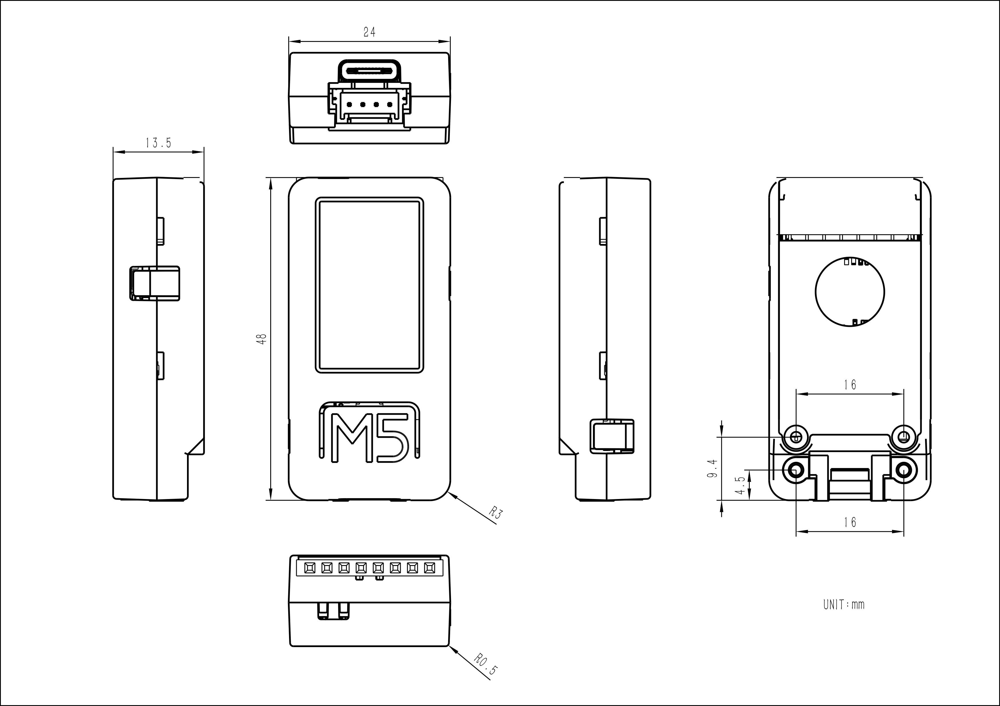
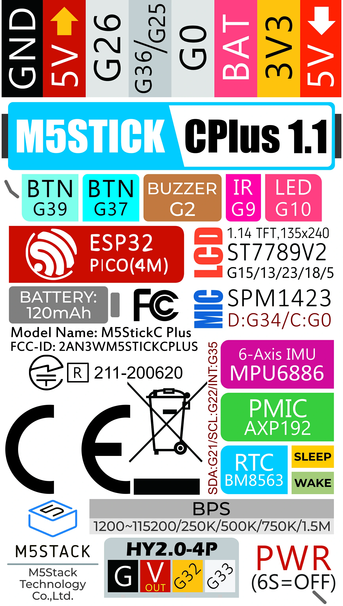
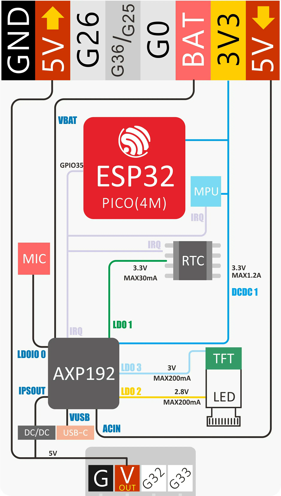
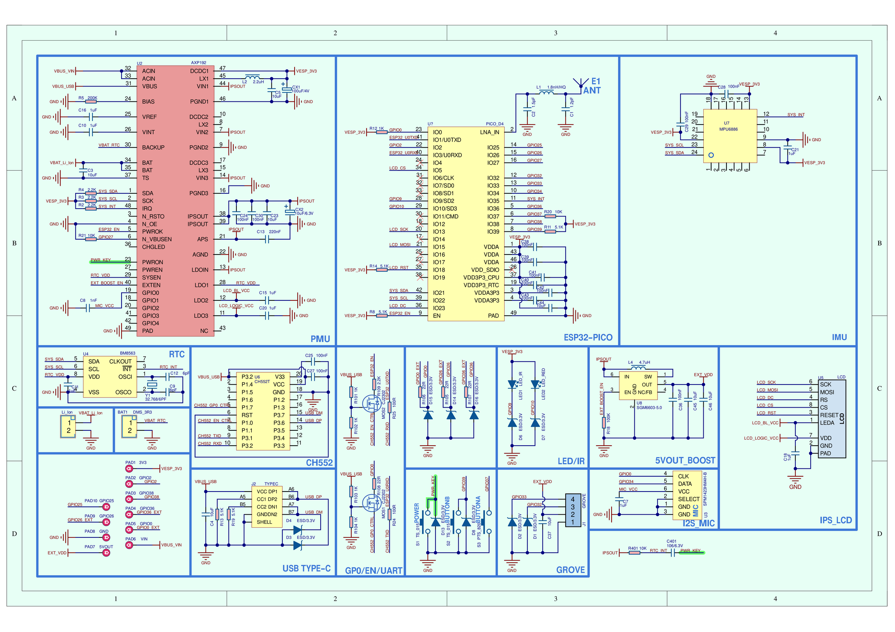

.. _esp32-m5-stickc-plus:

=====================
M5Stack M5StickC Plus
=====================

.. tags:: arch:xtensa, chip:esp32, part:esp32picod4, vendor:espressif

The `M5StickC Plus <https://docs.m5stack.com/en/core/m5stickc_plus>`_ is a
compact IoT development kit built around an ESP32-PICO-D4 SiP (dual Xtensa
LX6 @ 240 MHz, 4 MB flash, 520 KB SRAM).  It integrates a 1.14" ST7789v2
TFT, an AXP192 power management IC, a BM8563 RTC, an MPU6886 6-axis IMU, an
SPM1423 PDM microphone, a passive buzzer, an IR transmitter, a red LED and
two user buttons, all powered from an internal 120 mAh LiPo battery.

.. list-table::
   :align: center

   * - .. figure:: m5stickc-plus.png
          :align: center

          M5StickC Plus

     - .. figure:: m5stickc-plus-02.png
          :align: center

          M5StickC Plus

     - .. figure:: m5stickc-plus-03.png
          :align: center

          M5StickC Plus

Features
========

* ESP32-PICO-D4 (dual Xtensa LX6 @ 240 MHz), 4 MB flash, 520 KB SRAM
* Wi-Fi 4 (2.4 GHz) and Bluetooth (radio supported by the chip; no
  board configuration enables them yet)
* 1.14" 135x240 ST7789v2 TFT on SPI2 (SCK=GPIO13, MOSI=GPIO15,
  CS=GPIO5, DC=GPIO23, RST=GPIO18); backlight and panel logic powered
  from AXP192 LDO2/LDO3
* AXP192 PMIC on I2C0 (0x34): LCD rail bring-up and battery charging
* BM8563 RTC on I2C0 (0x51), register compatible with the PCF8563
  driver, battery backed
* MPU6886 6-axis IMU on I2C0 (0x68), served by the MPU6050 uORB driver
* SPM1423 PDM microphone (not supported yet)
* Passive buzzer on GPIO2 (LEDC), IR transmitter on GPIO9 (not
  supported yet), red LED on GPIO10 (active low)
* Two user buttons: GPIO37 (side button) and GPIO39 (front button);
  the red power button is wired to the AXP192, not to a GPIO

   MPU6886 triaxial direction

   Module dimensions (48.0 x 24.0 x 13.5 mm)

Power
=====

   Power structure (1/2)

   Power structure (2/2)

   Schematic; see the `M5Stack documentation
   <https://docs.m5stack.com/en/core/m5stickc_plus>`_ for the PDF version

Serial Console
==============

The NSH console runs on UART0, exposed through the on-board FT232
USB-to-UART bridge.  The board's USB-C connector is charge-only; the
FT232 bridge (typically ``/dev/ttyUSB0`` on Linux) is the only data
channel for flashing and the serial console, at 115200 8N1.

Configurations
==============

nsh
---

Basic NuttShell configuration.  Console on UART0 at 115200 bps.  The
ST7789v2 LCD is enabled through the lcd_framebuffer layer (``/dev/fb0``,
240x135 RGB565).  The on-board I2C devices are brought up: the AXP192
powers the LCD rails, the BM8563 is bound as the system RTC (the system
time is synchronized to it at boot), and the MPU6886 registers
``/dev/uorb/sensor_accel0`` and ``/dev/uorb/sensor_gyro0``.  littlefs on
the SPI flash (2.5 MB) is mounted at ``/data``.  The ``buttons``,
``fb``, ``hello``, ``leds`` and ``pwm`` built-in examples are enabled.

Flashing uses the simple boot layout (no second stage bootloader), so a
single image write is enough::

    $ ./tools/configure.sh esp32-m5-stickc-plus:nsh
    $ make -j
    $ esptool.py --chip esp32 --port /dev/ttyUSB0 --baud 115200 \
        write-flash 0x1000 nuttx.bin
